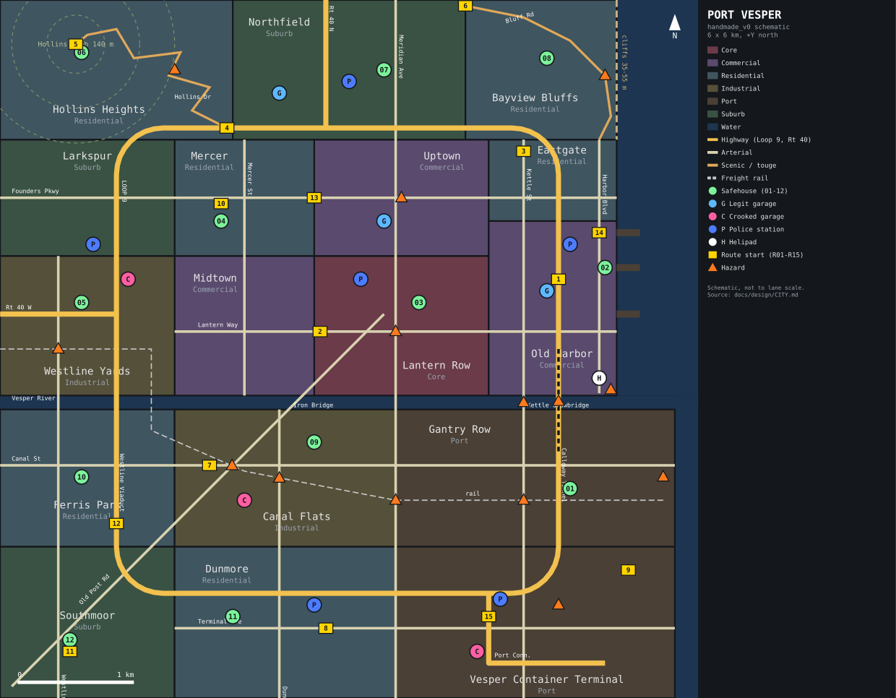

# Port Vesper — city design (handmade_v0)

**Owner:** workstream 19 (design docs). **Consumers:** 05 world (road graph, zones, POIs), 06 police
(presence by district, chokepoints), 15 race (routes, event circuits), 11 art (district looks),
13 audio (ambience by district), 14 weather (coast fog, cliff wind).

Files:
- this document (the spec),
- `docs/design/city_schematic.svg` (schematic map, generated from the same coordinates as the JSON),
- `data/city/handmade_v0.zones.json` (zones + POIs in the `wp_world` format, draft; no road graph yet).

Where this document and the JSON disagree, the JSON coordinates win and this text is the bug.

---

## 1. The pitch

Port Vesper is a fictional mid-size US East-Coast port city of about 400 000 people, built on both
banks of the **Vesper River** where it meets **Calder Bay**. It grew on shipping, rail and a steel
mill that closed in the 1980s. The money moved uptown and to the bluffs; the river flats kept the
rail yards, chop shops and empty warehouses. The container terminal still runs 24 hours a day,
which means there is always traffic somewhere, always noise to hide in, and always a reason for a
truck to be on the road at 3 a.m.

What makes it good to race and chase in:

- **A river with only six crossings.** Every cross-town run has to pick a bridge (or the tunnel).
  Police know this. Chokepoints are the backbone of police doctrine (see `POLICE_DOCTRINE.md` §4).
- **A highway loop** that rings the whole city: fast, but long sight lines favour the helicopter.
- **A hill district** in the north-west with a real touge road, and **sea bluffs** in the
  north-east with a cliff-edge two-lane.
- **A 24-hour port** whose container stacks are a maze that breaks line of sight.
- **A downtown core** with dense traffic, signals and green waves: high reward, high witness count.

Size: 6 × 6 km map, about 32 km² of land after water. Origin at the centre; metres; +X east,
+Y north, +Z up (same as `wp_world`). The density core is Lantern Row at (450, 200).

---

## 2. Districts

Every district is one `Zone` in `handmade_v0.zones.json` (`kind` = the contract's `DistrictKind`,
`density_base` in vehicles per lane-km; Core/Commercial/… defaults from `wp_world::density`
unless noted). Elevations are ground level at street grade.

| # | District | `district_kind` | Box (x0..x1, y0..y1 m) | Density | Elevation | Character |
|---|---|---|---|---|---|---|
| 1 | **Lantern Row** | Core | −300..1200, −400..800 | 30 | 4–12 m | Downtown. Towers, neon, bars open until 02:00, the most cameras and witnesses in the city. Named after the gas lamps on the old waterfront promenade. |
| 2 | **Midtown** | Commercial | −1500..−300, −400..800 | 22 | 5–15 m | Offices, malls, parking structures. Wide one-way pairs. Empty after 21:00. |
| 3 | **Uptown** | Commercial | −300..1200, 800..1800 | 20 | 12–26 m | Theatres, hotels, the civic plaza over Founders Cut. Valet traffic, taxis. |
| 4 | **Old Harbor** | Commercial | 1200..2300, −400..1100 | 18 | 2–5 m | Waterfront: fish market, ferry terminal, piers turned into restaurants. Cobblestone side streets. |
| 5 | **Mercer** | Residential | −1500..−300, 800..1800 | 14 | 15–25 m | Dense brick row houses, corner stores, tight parking. A school (day speed zone). The scene's oldest meet spot. |
| 6 | **Eastgate** | Residential | 1200..2300, 1100..1800 | 12 | 20–30 m | Mid-rise apartments climbing toward the bluffs. Steep cross streets down to Harbor Blvd. |
| 7 | **Westline Yards** | Industrial | −3000..−1500, −400..800 | 8 | 3–8 m | Freight rail yards, roundhouse, scrap dealers. Gravel lots and flat concrete. |
| 8 | **Larkspur** | Suburb | −3000..−1500, 800..1800 | 5 | 10–30 m | Post-war tract houses, strip malls, cul-de-sacs. Quiet at night; neighbours call in noise. |
| 9 | **Hollins Heights** | Residential | −3000..−1000, 1800..3000 | 7 | 25–140 m | Old-money hill houses on switchbacks. **Hollins Knob** (140 m) has an observatory lot with a view of everything. |
| 10 | **Northfield** | Suburb | −1000..1000, 1800..3000 | 5 | 20–40 m | Big-box retail, storage units, the North Precinct, Route 40 North out of town. |
| 11 | **Bayview Bluffs** | Residential | 1000..2300, 1800..3000 | 9 | 30–55 m | Expensive houses on cliffs over the bay. Bluff Road runs along the edge. Coastal fog. |
| 12 | **Ferris Park** | Residential | −3000..−1500, −1700..−520 | 12 | 5–12 m | Working-class south bank. A derelict drive-in cinema. |
| 13 | **Canal Flats** | Industrial | −1500..400, −1700..−520 | 8 | 1–4 m | Old mill land along the canal and the freight line. Body shops (honest and otherwise), the Five Points rail crossing, the drag strip on Canal St. |
| 14 | **Gantry Row** | Port | 400..2800, −1700..−520 | 6 | 2–4 m | Quay with ship-to-shore cranes, reefer warehouses, the rail spur. Lit like daytime all night. |
| 15 | **Southmoor** | Suburb | −3000..−1500, −3000..−1700 | 5 | 5–15 m | Newer suburb on the southern edge. Wide, empty streets at night. |
| 16 | **Dunmore** | Residential | −1500..400, −3000..−1700 | 11 | 3–8 m | Port workers' neighbourhood. The South Precinct. Tire yards. |
| 17 | **Vesper Container Terminal** | Port | 400..2800, −3000..−1700 | 5 | 2–4 m | Container stacks, straddle carriers, gates. Truck traffic peaks 06:00–18:00. |

Water: the Vesper River is a 120 m band at y −520..−400 across the whole map; Calder Bay is
everything east of x = 2300 north of the river and east of x = 2800 south of it (the port is
reclaimed land that sticks out further). Three piers at Old Harbor reach to x = 2500.

Elevation summary for the road graph (`Node.pos[2]`; the procedural city is flat today):
river flats and port 1–4 m; downtown 4–12 m rising north to Uptown 26 m; Hollins Heights is the
only real hill (25 → 140 m, grades up to 12 % on Hollins Drive); Bayview Bluffs is a plateau at
35–55 m ending in a cliff at the shore; the Westline Viaduct deck is 18 m; the Meridian Bridge deck
14 m; the Calloway Tunnel invert −22 m.

---

## 3. Road network

Speed limits follow the importer defaults in `wp_world` (US: residential 25 mph, collector 30–35,
arterial 35–45, highway 55–65). Right-hand traffic.

### Highways
| Road | Lanes | Limit | Length | Notes |
|---|---|---|---|---|
| **Loop 9** ("the Loop") | 3+3 | 55 mph (24.6 m/s) | 14.9 km | Rounded rectangle x −2000..1800, y −2100..1900, corner radius 400 m. East leg is the elevated **Harbor Skyway** (y 0..1900) then the **Calloway Tunnel** (y −900..0) under the river mouth. West leg crosses the yards and the river on the **Westline Viaduct** (y −900..0). |
| **Route 40 West** | 2+2 | 65 mph | 1.0 km in map | From the Loop at (−2000, 300) west out of the city. |
| **Route 40 North** | 2+2 | 65 mph | 1.1 km in map | From the Loop at (−200, 1900) north out of the city. |
| **Port Connector** | 2+2 | 45 mph | 1.6 km | From the Loop south leg at (1200, −2100) to the terminal gates. Truck route. |

Loop interchanges (7): Route 40 W (−2000, 300); Old Post Rd (−2000, −1500); Route 40 N (−200, 1900);
Meridian Ave (400, −2100); Harbor Blvd (1800, 1100); Kettle St (1800, −1500 via the port side);
Dunmore Ave (−600, −2100).

### Arterials and collectors
| Road | Lanes | Limit | Length | Runs |
|---|---|---|---|---|
| **Meridian Avenue** | 2+2 | 40 mph | 6.0 km | The north–south spine at x = 400, edge to edge; crosses the river on the fixed **Meridian Bridge**. |
| **Kettle Street** | 2+2 | 35 mph | 4.8 km | x = 1500 from Eastgate to the terminal; crosses the river on the **Kettle Street Drawbridge**. Downhill all the way south. |
| **Harbor Boulevard** | 2+2 + parking | 30 mph | 2.2 km | The waterfront at x = 2150, ends at the ferry terminal. |
| **Lantern Way** | 2+2 + bus | 35 mph | 3.8 km | East–west through downtown at y = 150. Dips under Meridian in the **Lantern Underpass**. Eastbound green wave. |
| **Founders Parkway** | 2+2 | 40 mph | 5.3 km | East–west at y = 1300; passes under the civic plaza in **Founders Cut** (400 m covered trench). |
| **Canal Street** | 2+2 | 40 mph | 5.8 km | East–west at y = −1000 on the south bank. Long, flat, empty at night: the drag strip. |
| **Terminal Avenue** | 2+2 | 40 mph | 4.3 km | East–west at y = −2400 along the terminal. |
| **Old Post Road** | 1+1 → 2+2 | 35 mph | 4.5 km | The colonial road: diagonal from Southmoor to Lantern Row. Crosses the river on the narrow **Iron Bridge**; meets Canal St and the rail line at **Five Points**. |
| **Westline Avenue** | 2+2 | 35 mph | 3.8 km | x = −2500 on the west side; crosses the river on the **Westline Low Bridge** right next to a rail crossing. |
| **Dunmore Avenue** | 2+2 | 30 mph | 2.5 km | x = −600, south bank. |
| **Mercer Street** | 1+1 + parking | 25 mph | 2.2 km | x = −900, through Mercer. School zone by day (15 mph 07:00–09:00, 14:00–16:00). |
| **Bluff Road** | 1+1 | 30 mph | ≈ 2.3 km road (2.0 km schematic) | Along the Bayview cliff edge; guardrail on the sea side only. |
| **Hollins Drive** | 1+1 | 25 mph (15 mph hairpin advisories) | ≈ 4.2 km road (2.3 km schematic) | The switchback climb from the Loop to Hollins Knob; 11 hairpins, blind crests. |

The schematic draws winding roads straightened. Hollins Drive's real lane polyline should be
about 1.9× its schematic length (the 4.2 km figure is the target), Bluff Road about 1.15×.

Local streets fill each district on a 100–140 m block grid (tighter in Mercer and Old Harbor,
looser in suburbs), with mid-block alleys in Lantern Row and Midtown, cul-de-sacs in Larkspur and
Southmoor, and gravel service roads in Westline Yards and the terminal.

### The six river crossings (chokepoints)
| Crossing | x | Road | Type | Lanes | Notes |
|---|---|---|---|---|---|
| Westline Low Bridge | −2500 | Westline Ave | fixed, low | 2+2 | Rail crossing 400 m north; a train here closes the crossing for everyone. |
| Westline Viaduct | −2000 | Loop 9 | elevated | 3+3 | Long sight lines; helicopter's favourite. |
| Iron Bridge | −480 | Old Post Rd | 1890s steel truss | 1+1 | Narrow, steel-grate deck (`SurfaceType::Metal`; very low grip wet). Easy roadblock. |
| Meridian Bridge | 400 | Meridian Ave | fixed, high | 2+2 | Central and obvious; the default police block point. |
| Kettle Street Drawbridge | 1500 | Kettle St | bascule (lifts) | 2+2 | Steel-plate deck. Lift schedule in §7. |
| Calloway Tunnel | 1800 | Loop 9 | immersed tube, 900 m | 3+3 | No helicopter line of sight inside; no phone signal (scanner static). |

### Rail
The **Westline freight line** runs from the Gantry Row quay west along y = −1300, bends north-west
through Canal Flats, crosses the river on a rail-only swing bridge at x = −1700 and runs west
through the yards at y = 0 to the map edge. Five at-grade crossings (§7).

---

## 4. Landmarks

| Landmark | Where | Why it matters |
|---|---|---|
| Hollins Knob Observatory | (−2300, 2550), 140 m | Highest point; safehouse SH06; end of the touge; the shot for photo mode. |
| The Lantern Promenade | Lantern Row waterfront | The district's namesake; the night skyline. |
| Calloway Tunnel | Loop east leg | The one place the helicopter goes blind. Racers know it. |
| Kettle Street Drawbridge | (1500, −460) | Bells, gates, a lifting deck. The city's most famous stunt. |
| Iron Bridge | (−480, −460) | Narrowest crossing; a car-width wreck closes it. |
| Gantry cranes | Gantry Row quay x 2600–2800 | Silhouettes visible from anywhere; red aircraft lights at night. |
| Founders Plaza | over Founders Cut, (450, 1300) | Civic centre, city hall; day events start here. |
| Starlite Drive-In | (−2300, −1100) | Derelict drive-in; safehouse SH10; night meets. |
| Westline Roundhouse | (−2300, 400) | Disused rail roundhouse; safehouse SH05; a crew HQ. |
| Pier 9 | (2200, 700) | Boathouse safehouse SH02; ferry horns. |
| Five Points | (−1006, −1003) | Old Post Rd, Canal St and the freight line meet at one skewed junction. |

---

## 5. Points of interest (in the JSON)

POI kinds are the `wp_world::PoiKind` variants. `lane` is `null` until the road graph exists;
05 snaps each POI to its nearest lane when building `handmade_v0.road.*`. Positions are
`[x, y, z]` with z = ground elevation; `heading_rad` is yaw about +Z, 0 = facing +Y (north),
positive = counter-clockwise (so east = −π/2).

### 5.1 Twelve safehouses (`SafehouseCandidate`)
Rules from 06: a pursuit ends when the racer sits inside a safehouse POI for 10 s with no unit
within 150 m. So every safehouse needs a **covered approach** (somewhere you can break line of
sight in the last 300 m) and **one way in** (so it is a commitment, not a free reset).

| Id | Name | District | Pos (x, y, z) | Approach / trade-off |
|---|---|---|---|---|
| SH01 | The Coldroom | Gantry Row | (1900, −1200, 3) | Abandoned reefer warehouse among container stacks; easy to lose cops, but the port is patrolled by Highway Post 9. |
| SH02 | Pier 9 Boathouse | Old Harbor | (2200, 700, 2) | End of a pier: one road in, water on three sides. Close to Harbor Precinct (bold). |
| SH03 | Lantern Garage Level 4 | Lantern Row | (600, 400, 8) | Multi-storey car park: the helicopter cannot see inside. Downtown means many witnesses on the way in. |
| SH04 | Mercer Wash-n-Fold Lot | Mercer | (−1100, 1100, 22) | Rear lot of a laundromat off an alley; the scene's oldest hideout. Tight alleys punish wide cars. |
| SH05 | Westline Roundhouse | Westline Yards | (−2300, 400, 6) | Inside the disused roundhouse; reached over gravel and a rail crossing. |
| SH06 | Knob Observatory Lot | Hollins Heights | (−2300, 2550, 138) | Top of the touge; a long climb with nowhere to hide on the last km. Proposed rep bonus for escapes that end here (GDD §5.4). |
| SH07 | Northfield Self-Storage | Northfield | (300, 2400, 34) | Rented unit; two blocks from North Precinct. |
| SH08 | Cliffside Carport | Bayview Bluffs | (1700, 2500, 48) | Under a cantilevered house off Bluff Road; fog often covers it. |
| SH09 | Sluice House | Canal Flats | (−300, −800, 2) | Old pump house on the canal; reached via the Iron Bridge or Five Points. |
| SH10 | Starlite Drive-In | Ferris Park | (−2300, −1100, 9) | Behind the screen tower; a night-meet venue (heat cost if you meet and hide in the same place). |
| SH11 | Dunmore Tire Yard | Dunmore | (−1000, −2300, 7) | Between tire stacks; a cousin's business. South Precinct is close. |
| SH12 | Briar Court Garage | Southmoor | (−2400, −2500, 12) | Suburban garage at the end of a cul-de-sac; neighbours report noise at night (slow heat build if used repeatedly). |

Crew territory (15) adds one more safehouse per controlled district; those are chosen from this
list, not new sites.

### 5.2 Six garages (`Garage`)
`wp_economy` already models the difference: **legit** shops charge normal labour and report wanted
cars at level 2+; **crooked** shops charge ×1.15 labour (×1.6 for a wanted car) and never report.
`PoiKind` has no field for this yet; the JSON carries `"shop": "legit" | "crooked"` (see §9).

| Shop | Kind | District | Pos | Notes |
|---|---|---|---|---|
| Meridian Motorworks | legit | Uptown | (300, 1100, 14) | Dealer-grade, clean, cameras in the lot. |
| Harbor Auto Body | legit | Old Harbor | (1700, 500, 4) | Collision specialist; insurance work. |
| Northfield Tire & Service | legit | Northfield | (−600, 2200, 30) | Tires, alignment, cheap labour; next to the precinct. |
| Sal's Paint & Panel | crooked | Canal Flats | (−900, −1300, 3) | Body work and fresh paint, no questions. |
| Gantry Garage | crooked | Vesper Container Terminal | (1100, −2600, 3) | Inside the port fence; engines and parts "off the boat". |
| Roundhouse Customs | crooked | Westline Yards | (−1900, 600, 7) | Tuning shop and crew hangout; performance mods. |

Layout intent: legit shops are north of the river and near precincts; crooked shops are south of
the river or in the yards. Getting a wanted car repaired cheaply means a river crossing.

### 5.3 Police stations and helipad
| POI | Kind | District | Pos | Call-sign prefix |
|---|---|---|---|---|
| Central Precinct | PoliceStation | Lantern Row | (100, 600, 9) | Central |
| Harbor Precinct | PoliceStation | Old Harbor | (1900, 900, 4) | Harbor |
| North Precinct | PoliceStation | Northfield | (0, 2300, 32) | North |
| South Precinct | PoliceStation | Dunmore | (−300, −2200, 6) | South |
| Westline Precinct | PoliceStation | Larkspur | (−2200, 900, 10) | West |
| Highway Patrol Post 9 | PoliceStation | Vesper Container Terminal | (1300, −2150, 4) | Loop |
| Harbor Air Support Pad | Helipad | Old Harbor | (2150, −250, 3) | Skywatch |

Patrol counts per district by day phase live in `data/police/presence.toml` (06). The design
intent for the 17 districts, so 06 can fill the table:

| District group | Day | Dusk | Night | Dawn |
|---|---|---|---|---|
| Lantern Row (Core) | 8 | 6 | 3 | 2 |
| Commercial (Midtown, Uptown, Old Harbor) | 4 each | 3 | 2 | 1 |
| Residential (Mercer, Eastgate, Hollins, Bayview, Ferris Park, Dunmore) | 2 each | 2 | 1 | 1 |
| Industrial (Westline Yards, Canal Flats) | 2 each | 1 | 1 | 0 |
| Port (Gantry Row, Container Terminal) | 2 each (+ Loop units) | 1 | 1 | 1 |
| Suburb (Larkspur, Northfield, Southmoor) | 3 each | 2 | 1 | 1 |
| Loop 9 (Highway Post 9) | 3 | 2 | 2 | 1 |

### 5.4 Race start grids (`RaceStartGrid`)
One grid per named route (§6), with `"route": N` in the JSON. Grids face the race direction.

---

## 6. Fifteen named routes

Race types are the `wp_race` set (Sprint, Circuit, Outrun, Checkpoint, Cannonball, Delivery, Drag,
TimeAttack) plus `wp_economy`'s Touge and Meet. Lengths are design targets for 05's route helper,
± 10 %. Difficulty 1–5 (5 = only for experienced drivers in Simulation). Traffic character is at
night unless noted.

| # | Route | Type | Length | Diff. | Path | Traffic character | Signature |
|---|---|---|---|---|---|---|---|
| R01 | **The Loop** | Circuit (1–2 laps) | 14.9 km / lap | 3 | Loop 9 all the way round, from the Harbor Skyway | Highway: sparse at night, trucks near the Port Connector by day | Calloway Tunnel blinds the helicopter; Westline Viaduct exposes you. |
| R02 | **Lantern Run** | Sprint | 6.0 km | 4 | Lantern Way east → Old Post Rd → Meridian Ave south → Harbor Blvd | Densest in the city; nightlife traffic to 02:00; signals every 120 m; eastbound green wave | Highest witness count = fastest heat. The "prestige" street race. |
| R03 | **Kettle Street Drop** | Sprint | 5.2 km | 3 | Kettle St from Eastgate south over the drawbridge, east on Terminal Ave | Light; port trucks after 05:00 | 23 m of downhill; arrive at the drawbridge at the wrong time and you wait or jump. |
| R04 | **Hollins Ascent** | Touge (uphill) | 4.2 km | 5 | Hollins Drive from the Loop to the Knob | Almost none; parked cars at the bottom | 11 hairpins, 114 m climb, guardrail-free drops. |
| R05 | **Hollins Descent** | Touge (downhill) | 4.2 km | 5 | Hollins Drive reversed | Almost none | Brake fade territory; a mistake is a tree. |
| R06 | **Bluff Road** | Sprint / Outrun | 4.0 km | 4 | Bluff Rd from Northfield along the cliffs, down Harbor Blvd to Lantern Way | Very light; residents' cars | Fog bank most nights; the sea-side guardrail is the only thing between you and the bay. |
| R07 | **Canal Street Quarter** | Drag | 402 m | 1 | Canal St westbound from Five Points | Empty at night | Freight trains at Five Points behind the start line can cut off responding units. |
| R08 | **Terminal Half** | Drag | 804 m | 2 | Terminal Ave eastbound | Empty at night; heavy trucks by day | Longer drag for high-power cars; the port's floodlights make it the best-lit strip in town. |
| R09 | **Gantry Maze** | Circuit (3 laps) | 3.1 km / lap | 3 | Service roads through the container stacks | No civilians; straddle carriers and terminal trucks | Stack canyons break line of sight; carriers are 60 t kinematic obstacles. |
| R10 | **Mercer Meet** | Meet (sprint) | 3.4 km | 2 | Founders Pkwy east from the laundromat lot → Meridian south → Lantern Way | Residential, tight parking | Free entry: the race you can run while in debt. School zone by day. |
| R11 | **Cross-Town Cannonball** | Cannonball | 6.5 km straight line, 8.5–9.5 km driven | 4 | Briar Court (Southmoor) → Cliffside Carport (Bayview), any path | Every type of traffic | Must pick one of six river crossings; police block the obvious ones. |
| R12 | **Westline Viaduct** | Outrun | open, ≈ 6.5 km corridor | 3 | Loop west and north legs from Old Post Rd interchange; Route 40 W as escape exit | Highway, sparse | 1v1 gap race on the widest road in town. |
| R13 | **Founders Cut** | Circuit (2 laps) | 4.9 km / lap | 3 | Founders Pkwy (through the Cut) → Meridian → Lantern Way → Mercer St | Moderate; taxis and valet stops in Uptown | Covered trench section: radio and helicopter lose you for 400 m every lap. |
| R14 | **Harbor Checkpoint** | Checkpoint (5 CPs) | ≈ 7.5 km shortest | 3 | Pier 6 → ferry ramp → Lantern Garage → Iron Bridge → Meridian Bridge → Kettle Drawbridge → Pier 9 | Mixed, waterfront tourists by day | Open routing; crosses the river twice. |
| R15 | **Iron Bridge Delivery** | Delivery | ≈ 8.6 km | 4 | Terminal (pickup) → Iron Bridge → Old Post Rd → Hollins Drive → Knob | Port trucks, then empty hills | Cargo mass up a 12 % grade, over a steel-grate bridge. |

TimeAttack can run on any route; leaderboards (18) are kept per route id `R01`–`R15`.

Illegal **daytime** street races (15's rare high-heat events, `police_presence_override: max`)
use R02, R03, R11 or R14: the routes where daytime traffic and patrol density make it a spectacle.

---

## 7. Day event circuits (sanctioned, closed)

Sanctioned events run in daylight on closed roads (05's `RouteClosure`: traffic suppressed, cones
as static colliders, marshals as static entities). No heat is generated inside the closure;
leaving the corridor is a DQ and a violation. Police presence on the city outside is normal.

| Circuit | Lap | Where | Format | Notes |
|---|---|---|---|---|
| **Harbor Grand Prix** | 3.8 km | Harbor Blvd → Lantern Way → Kettle St → waterfront service road | Circuit, 5–8 laps, grid of 12 | The city's flagship weekend event. Cobblestone chicane in Old Harbor. |
| **Founders Plaza Criterium** | 2.4 km | Rectangle around Uptown blocks, through Founders Cut | Circuit, 10 laps | Tight, technical, lots of kerbs. |
| **Terminal Autocross** | 1.6 km | Coned course in an empty container block | TimeAttack, 3 runs | Low speed, high precision; good onboarding event. |
| **Westline Mixed Surface** | 2.2 km | Concrete aprons and gravel lots in the yards | Circuit, 6 laps | `Gravel` + `Concrete` + `Metal` (rails) surfaces; rewards durable cars. |

---

## 8. Hazards

These are things that change how a chase or race plays out. Static ones are geometry/surface;
dynamic ones need world entities (requests in §9).

| Hazard | Where | Kind | Behaviour |
|---|---|---|---|
| **Kettle Street Drawbridge** | (1500, −460) | dynamic | Lifts every 2 game hours (12 real minutes at the default 10× clock), on the even hour. Sequence: bells + flashing signals 20 s → gate arms down 10 s → deck rises to 70° in 45 s → open 60 s → closes 45 s → gates up. Deck below 4° and rising: jumpable at speed (the city's legend; ruinous on landing). Above 8°: a wall. Steel-plate deck is `Metal`. Police use the lift as a free roadblock. |
| **Calloway Tunnel** | Loop 9, x = 1800, y −900..0 | static | 900 m tube: no helicopter LOS, scanner static, sodium lighting. Tunnel walls are concrete (expensive contact). |
| **Founders Cut** | Founders Pkwy, (450, 1300) | static | 400 m covered trench, same LOS rule. |
| **Lantern Underpass** | Lantern Way under Meridian, (400, 150) | static | 220 m; low clearance sign; floods in heavy rain (14's puddle cells). |
| **Five Points crossing** | (−1006, −1003) | dynamic | Rail crossing through the skewed Canal St / Old Post Rd junction. |
| **Rail × Kettle St** | (1500, −1300) | dynamic | Port spur; slow trains, long consists. |
| **Rail × Meridian Ave** | (400, −1300) | dynamic | Busy arterial crossing. |
| **Rail × Dunmore Ave** | (−600, −1110) | dynamic | Residential crossing. |
| **Rail × Westline Ave** | (−2500, 0) | dynamic | 400 m north of the Westline Low Bridge. |
| Freight trains (all crossings) | Westline freight line | dynamic | At night a train every ~20 game minutes (2 real minutes), 60–120 s real blockage per crossing. Gates + bells 15 s before. A train is a kinematic, effectively infinite-mass collider: contact is a total loss in both modes. |
| **Ship-to-shore cranes** | Gantry Row quay x 2600–2800 | static | Crane legs are concrete-anchored steel columns at road edges; spreaders overhead are visual only. |
| **Straddle carriers** | Container terminal service roads | dynamic | 60 t, ~25 km/h, on fixed loops; they do not yield. |
| **Container stack canyons** | Port districts | static | Line-of-sight breakers, single-lane gaps, blind 90° corners. |
| **Ferry ramp** | (2250, −350) | dynamic | Ferry departs every game hour; the ramp lifts. Racers have tried. |
| **Bluff Road cliff edge** | Bayview Bluffs | static | Guardrail on the sea side; a breach is a fall (total loss + respawn). |
| **Hollins Drive blind crests** | Hollins Heights | static | Crests and hairpins with < 60 m sight distance: 06 must never place roadblocks or spikes here (its 120 m sight rule). |
| **Iron Bridge deck** | (−480, −460) | static | Steel grate (`Metal`): fine dry, treacherous wet. 1+1 lanes, no shoulder. |
| **Cobblestones** | Old Harbor side streets | static | Lower grip, rumble (proposed surface, see §9). |
| **School zone** | Mercer St | timed | 15 mph during school hours; speeding here weighs double for heat (06). |
| **Coastal fog** | Bayview Bluffs, Old Harbor | weather | 14's fog density is highest here at night and dawn. |

---

## 9. Requests to other workstreams

These are proposals. Owners decide; contract-level changes go through the lead
(`docs/integration/design-docs.md` mirrors them).

| # | To | Proposal | Why |
|---|---|---|---|
| C1 | 05 world | Build `handmade_v0.road.{bin,json}` from this doc; snap POIs to lanes; elevations per §2. | The procedural city is a test fixture; this is the design target. |
| C2 | 05 / lead | `Zone.name: Option<String>` (or `DistrictId`, deferred to contract v0.3.0), so UI, crews, police and economy refer to "Mercer", not zone 4. | Territory (15), heat maps (06), district labour (08) all need a stable district identity. |
| C3 | 05 / 08 | Garage shop kind on the POI (`Garage { legit: bool }` or `PoiKind::CrookedGarage`). | 08 already prices legit vs crooked; the map must say which is which. |
| C4 | 05 | Dynamic world entities: drawbridge (deck angle, gate state), rail crossings + trains, ferry ramp, straddle carriers. Deterministic schedules from the world clock. | Hazards in §8. |
| C5 | 05 / 06 | Tunnel / covered-road flag on lanes (`covered: bool`) used by LOS queries. Contract v0.2.0 added `WorldQuery::line_of_sight`, which today tests 2D building footprints only, so covered roads still need this flag. | Helicopter and camera LOS rules (Calloway, Founders Cut, parking structures). |
| C6 | 02 / lead | Surface types `Cobblestone` and `SteelGrate` (or document that `Metal` covers grates). | Old Harbor, Iron Bridge. |
| C7 | 05 | Timed speed zones (school zone) as lane metadata. | Mercer St. |
| C8 | 15 | Use route ids R01–R15 and the circuits in §7 as the first event data set. | Shared names across UI, leaderboards and radio lines. |
