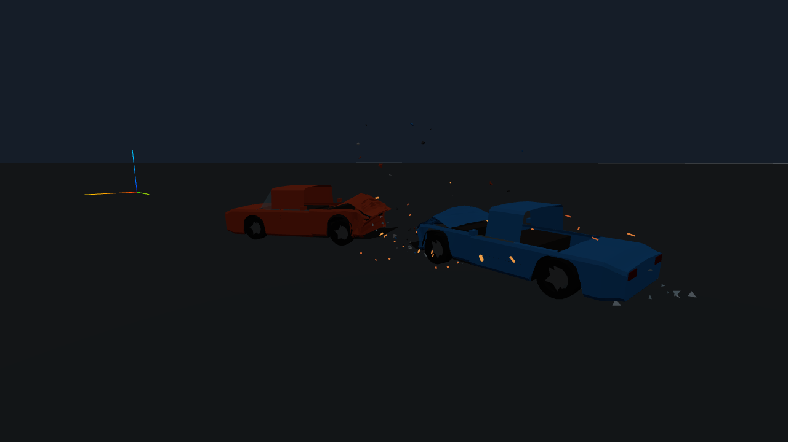
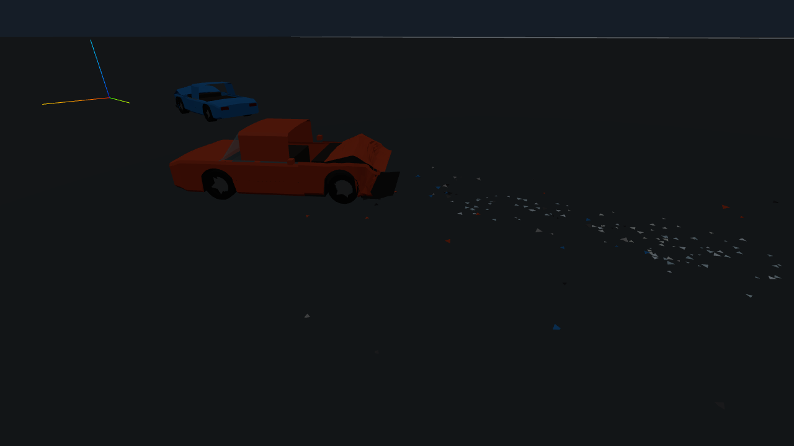
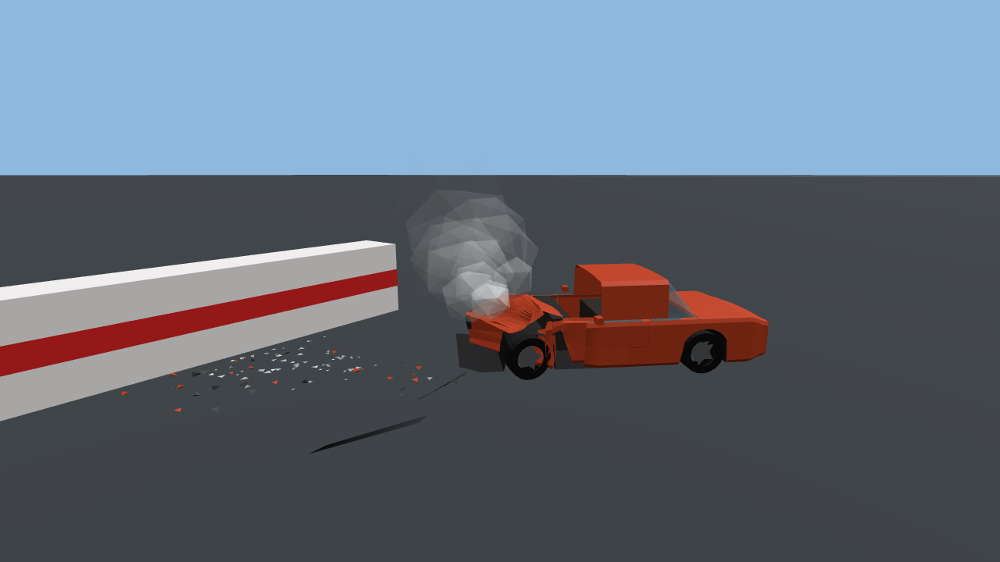
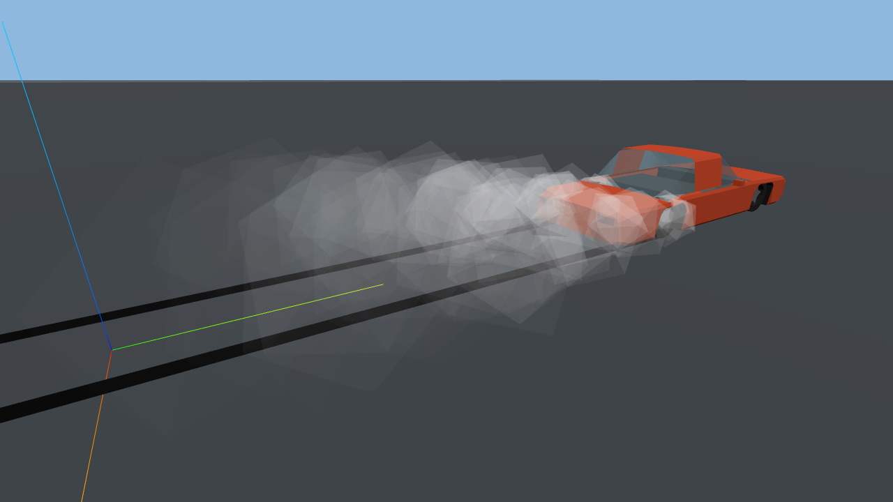
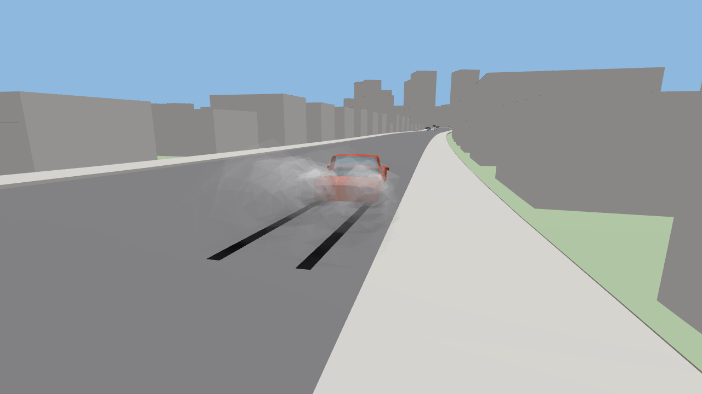

# Crash effects (`lead/crash-fx`)

- **Who:** helper for the integration lead, 2026-10-20 (owner request, playtest row 69: "crash
  effects that make impacts feel heavy").
- **Branch:** `lead/crash-fx` from `origin/lead/round12`.
- **Touched:** `apps/testbed-web` only (TypeScript + e2e) and this doc. **No Rust, no `data/`,
  no `wp_contracts`.** The effects are purely visual: they read the events and vehicle states
  the frame loop already has, never call into the sim and never feed anything back, so
  determinism and the goldens cannot move.



| | |
|---|---|
|  |  |
|  |  |

## What it draws

All in `apps/testbed-web/src/render/fx/`, one `CrashFx` object added to the scene's Z-up
`world` group (sim coordinates). Each effect is one pooled mesh = **at most 5 draw calls**, a
mesh with nothing live is hidden (0 draw calls when nothing happens).

| Effect | Trigger (existing data only) | Look |
|---|---|---|
| **Sparks** (`sparks.ts`) | `SimEvent::Contact`: a **scrape** (sliding speed > 2.5 m/s, impulse > 60 N·s per tick) throws a stream along the sliding direction; a **hard hit** (closing speed > 3.5 m/s, impulse > 250 N·s, debounced 0.3 s per pair) a wide burst. Count scales with sliding speed × impulse. | Unlit, not tone-mapped thin boxes stretched along their velocity (motion streaks), white-yellow → orange → dull red, bounce once on the road. Night: thicker, longer-lived, full brightness (they are emissive; S's bloom will pick them up). Against a wall / the road they kick off the surface; between two cars they kick upward (not into a body). |
| **Smoke** (`smoke.ts`) | Engine / radiator health from `ComponentDamaged` / `ComponentFailed` (all cars) and, for the focus car, the telemetry component block (the HUD's damage summary: a repair stops the smoke); `TotalLoss` → engine 0.15. Tyre smoke from wheel slip (below). | Flat-shaded icosahedron puffs that rise, grow and fade (per-instance alpha). Radiator < 0.7: white steam from the grille. Engine < 0.55: grey → black, thicker, as health → 0, from the hood. Tyres: thin light-grey puffs, low and wide. |
| **Glass** (`bits.ts`) | `GlassShattered { region }` → shards at that region's glass parts (panel mesh centre via `PanelBody.materialCentre`, else a per-region fallback); `RegionDamaged` front / rear ≥ 0.45 severity → head- / taillight lens shards (once per car end). | Small flat-shaded triangles (double-sided, slight emissive glint), tumble, bounce, lie flat, stay 6–12 s, shrink away. |
| **Skid marks** (`skids.ts`) | Per wheel from `vehicle_states()`: contact + load > 300 N and tread slip speed > 4 m/s (`\|ω·r − v_long\|` and `v_lat` at the contact patch, incl. yaw rate: burnouts, lock-ups, drifts). | Dark ribbons, one ring buffer of quads (0.35 m segments). Laid at the wheel's physics contact patch (road surface incl. hills / bridges) + 1.5 cm, `polygonOffset` −4/−8, no depth write: no z-fighting. Strength = slip. Fade in the shader from each vertex's birth time (no per-frame CPU work for old marks) after 1 / 2.5 / 5 min (low / med / high). |
| **Debris** (`bits.ts`) | Hard hits (above) and `PartDetached` (a few chips next to the existing panel debris). | Squashed tetrahedra in both cars' paint, black / dark plastic and metal; kinematic arcs (no physics bodies), bounce, rest flat, stay 25 / 60 / 120 s. |

Ground height for bits and sparks: each car's wheel contacts give a local plane
(`z = a + b·x + c·y`, refreshed every frame while ≥ 3 wheels touch); a spawned piece keeps the
plane of the car it came from, so debris lands on sloped streets (fallback: the contact point).

## API (for machine M's settings screen and automation)

```ts
import { CrashFx, FX_PRESETS } from "./render/fx";   // window.__wp.fx in the testbed
fx.setQuality("low" | "med" | "high");  // live; lowering drops the excess
fx.quality;                              // current level
fx.stats();  // { quality, sparks, smoke, shards, chips, skidSegments, alive: {...}, drawCalls }
```

- Start level: `render/quality.ts` → `Quality.fx` = `?fx=low|med|high`, else the stored choice
  (`setFxLevel(level)` writes `wp.fx` in `localStorage`), else **low on the low / software-GL
  profile, high otherwise**. The settings screen should call both `setFxLevel` (persist) and
  `__wp.fx.setQuality` / `fx.setQuality` (apply now).
- Frame loop hooks (`main.ts`, minimal): construct + `scene.world.add(fx.group)`, `fx.reset()`
  in `rebuildViews`, `fx.componentHealth(focus, telemetry, …)` + `fx.frame(events, states,
  views, dt, night)` after the events are drained, profiler section `"fx"` (`src/perf.ts`).

| Preset | sparks | smoke | shards | chips | skid segments | skid fade | rate | tyre smoke |
|---|---|---|---|---|---|---|---|---|
| low | 160 | 96 | 96 | 128 | 2048 (≈ 0.7 km of ribbon) | 60 s | 0.45 | 0.35 |
| med | 400 | 192 | 192 | 320 | 6144 | 150 s | 0.75 | 0.7 |
| high | 800 | 320 | 384 | 640 | 12288 (≈ 4.3 km) | 300 s | 1 | 1 |

Pools are allocated at the high size once; quality only changes caps (no rebuild). When a pool
is full the oldest-ish particle is replaced round-robin; the skid ring overwrites its oldest
segment.

## No per-frame allocation

Particle state is one `Float32Array` per pool (30 floats per particle, swap-remove), uploads
use one permanent update range per attribute (Three's `addUpdateRange` allocates a range object
and its array storage every call), emitters pass reusable argument objects (`SparkArgs`,
`PuffArgs`, `BitArgs`, `SkidArgs`) instead of many numeric arguments (V8 boxes a computed
double passed to a function it does not inline), and `Math.hypot` is avoided (it allocates its
argument list). The e2e measures it with the sampling heap profiler: **≈ 0.45–0.6 KB per
effects frame** remain, all V8 number boxing in functions not yet in the top JIT tier (Maglev:
`vehicles`, `puff`; checked with `%GetOptimizationStatus`), no object or array allocation; for
scale, the whole testbed frame allocates 1000–1600 KB in the chase.

## Perf

| Measurement (headless Chromium, SwiftShader, 4 cores) | Value |
|---|---|
| `fx` section, city chase, auto → fx **low** (`e2e/perf_check.mjs`, 12 s windows, ~2 fps so each frame covers ~0.5 s of sim; 4 runs) | 0.30–0.43 ms/frame (chase), 0.23–0.44 (rain); ≤ 5 draw calls. Most of it is the per-car wheel pass over ~18 cars under a CPU shared with SwiftShader's raster threads |
| One effects frame at **high**, 41–50 puffs + 22–30 skid segments live, one car (`e2e/crash_fx.mjs`, warmed JIT) | 0.010–0.018 ms |
| Added draw calls | 0 idle, ≤ 5 with every effect live |
| Added triangles | ≤ 12 per spark, 20 per puff, 1 per shard, 4 per chip, 2 per skid segment (only live instances drawn): < 40k at high with everything full |
| Material version bumps / shader churn | 0 (checked in the chase with 4 effect meshes live) |

`e2e/perf_check.mjs` now also fails if the `fx` section exceeds **1.0 ms/frame** (≈ 2× measured) or the effects
draw more than 5 calls, and prints the effect counts of the window; `e2e/frame_profile.mjs`
reports `structure.fx` and the names of materials that churned (`structure.churned`).

**Pre-existing perf-check failures on this container (not from this branch):** the same check
on the untouched base (`091cd34`, my changes stashed, same wasm, same session) fails the same
way: chase real-time factor 0.52 (mine 0.49 / 0.49), rain 0.48 (mine 0.45 / 0.48), 23–24 frames
over 250 ms (≤ 12), **1.42–1.45 M triangles** (limit 700k; browser-perf.md measured ~340k
before the round-12b props / parked cars). The effects cost ≤ 0.44 ms of a ~500 ms frame here;
the RTF difference is run-to-run noise of the chase (±10 % per browser-perf.md). One earlier run
showed 6 material version bumps; repeat runs (with effect meshes live) show 0, and a targeted
probe (head-on, all effects live, 3 steady renders × 4) showed none on the effect materials.

## e2e

`e2e/crash_fx.mjs` (`npm run e2e:fx`; step 9 of `e2e/run.mjs` = `just web-e2e`;
`FX_SHOTS=dir` writes the screenshots above):

1. Head-on (`crash/head_on.ron`, 80 km/h, 23:00): sparks ≥ 20, glass shards ≥ 10, debris ≥ 5,
   ≤ 5 draw calls; bits still alive on the ground 3 s later and none below its ground plane.
2. Simulation barrier crash (`crash/barrier_frontal_sim.ron`): steam / smoke puffs.
3. Burnout (RWD `ironside_440`, TCS off by default, full throttle from rest): skid segments and
   tyre smoke; 3b. the same on the Port Vesper v2 spawn (≈ 12 m up a 6–7 % grade): the marks
   sit on the hill road and climb with it.
4. Steady-state allocation of the effects < 1 KB/frame (sampling heap profiler, 600 warmed
   frames with smoke + skids live); prints the effects frame cost.
5. The marks stay after the car has driven off.
6. `setQuality("low")` / `"high"` set the caps; no page errors.

## For machine S (ws/art restyle) and machine M (ws/ui settings)

- **S:** effect materials are created in `render/fx/*.ts` (sparks `MeshBasicMaterial`
  `toneMapped: false`; smoke `MeshLambertMaterial` flat + `aAlpha`; shards / chips
  `MeshStandardMaterial` flat; skids `MeshBasicMaterial` + `aSkid`). Colours are in the files
  (spark ramp, `GLASS_COLOURS`, chip colours, smoke greys); move them to `palette.ts` when it
  lands. Keep the `onBeforeCompile` hooks (instance alpha, skid fade) and `customProgramCacheKey`.
  Sparks are meant for bloom; no point lights were added.
- **M:** the settings screen only needs `setFxLevel()` + `fx.setQuality()` (above). The FX code
  has no UI.

## Changes outside `render/fx/`

All in `apps/testbed-web`: `main.ts` (hooks above, `__wp.fx`, `?fx=` in the header),
`render/quality.ts` (`FxLevel`, `fxLevel()`, `setFxLevel()`, `Quality.fx`), `perf.ts`
(section `"fx"`), `render/panels.ts` (`PanelBody.materialCentre()`, read-only), `e2e/run.mjs`
(step 9), `e2e/perf_check.mjs` + `e2e/frame_profile.mjs` (fx budget, churn names),
`package.json` (`e2e:fx`), `README.md`.

## Known gaps

- Engine smoke comes from the front of the hood; no car file says where the engine is (a
  mid / rear-engine car smokes from the front). A `layout` / engine position in the car JSON
  (or component node positions in `vehicle_info`) would fix it.
- Skid marks ignore the surface (they also print on grass / gravel / wet roads); telemetry has
  the per-wheel surface only for the focus car. Cars drawn only by the instanced fleet (LOD,
  no full `VehicleView`) make no effects.
- Sparks come from any hard contact: plastic bumpers spark too (no material per contact point
  in `Contact`).
- Bits use the source car's ground plane; a piece that flies far over a kerb or a crest can
  float or sink a few cm until it fades.
- Headlight / taillight shards key off `RegionDamaged` severity, not the panel renderer's own
  "lens broken" state, so they can burst slightly before / after the lens goes dark.

## Gates (2026-10-20, cloud container, `CARGO_INCREMENTAL=0`, debug info off)

| Gate | Result |
|---|---|
| `cargo fmt --all -- --check` | pass |
| `cargo clippy --workspace -- -D warnings` | pass |
| `cargo test --workspace` | **1 failure, pre-existing:** `simcli` `goldens_match` — 16 goldens (city, siren, chase, races, weather, panels, police) no longer matched on the base `091cd34` (an earlier version of this line said 4: a truncated log). This branch changes no Rust, `data/` or golden file. Re-blessed on `lead/round12` in `b95fc4f` (49 goldens, scenarios tests 11/11). Everything else passes. |
| `cargo build --target wasm32-unknown-unknown -p wp_wasm` | pass |
| `npm run typecheck` (tsc) | pass |
| `just web-e2e` | 103 checks pass, incl. **crash effects (e2e/crash_fx.mjs)** and every effects line of the perf check; **fails only the perf check's pre-existing lines** (real-time factor 0.46 / 0.46, 21 frames > 250 ms, 1.39–1.43 M triangles: same as the base, see Perf). `e2e/race.mjs` (not reached because `run.mjs` exits 1) run separately: all race checks pass. |
