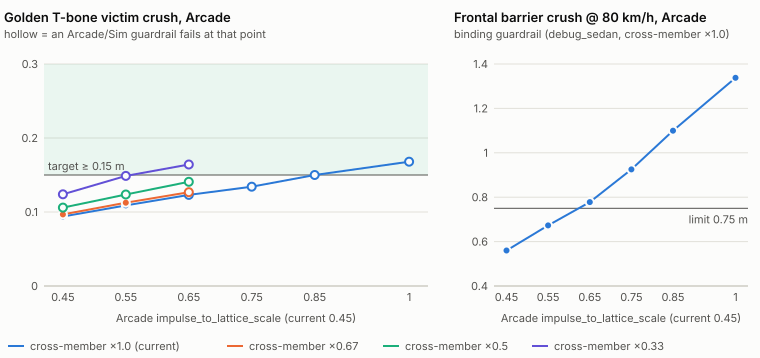

# Tuning dashboard integration notes

- **Workstream / prompt:** 20 — tuning dashboard (machine Q)
- **Branch:** `ws/tuning-dash`
- **Crates / folders owned:** `tools/tuning-dash/` (Rust crate `tuning-probe` in
  `tools/tuning-dash/probe`, Python `tuning_dash`, `web/`, `presets/`), `docs/TUNING.md`
- **Contract version built against:** 0.2.0 (merged `main` after lead run 3)

## Exposes
- `tools/tuning-dash/tune.py {sweep, presets, list, show, diff, promote, serve}` — see
  `tools/tuning-dash/README.md`; `just tune <spec>`, `just tune-dash`, `just tune-test`.
- Sweep spec format (YAML/JSON) and `out/sweeps/<name>/sweep.json` (format 1).
- `tuning-probe` CLI (`run <job.json>`, `resolve`, `diff`, `promote`) and library
  (`tuning_probe::{path, overrides, probe, promote, textedit, diff}`): parameter targets
  `<file>:<field path>` with selectors, in-memory overrides (`Overlay` implements
  `simcli::DataSource`), one-line text edits of JSON/TOML data files.
- `docs/TUNING_CHANGELOG.md` (created by the first promote): one line per promoted file.
- Presets: `tire_lateral_bcde`, `tire_longitudinal_bcde`, `spring_damper`, `arb_balance`,
  `impulse_to_lattice_scale`, `plasticity_scale`, `barrier_speeds`, `compare_sedan_coupe`,
  `damage_scenarios_plasticity`, `sedan_brakes`, `drivetrain_options` (v0.2.0 optional fields),
  `b_crush_arcade_table`, `b_crush_arcade_plasticity`, `b_crush_side_lattice` (crash-target study for B).

## Needs
| from | what | why | workaround |
|---|---|---|---|
| 03 (B, damage) | `barrier::run_scenario_with(&BarrierScenario, &LoadedCar, &ModeTable)` (or `run_scenario` over a `simcli::DataSource`) | the probe applies overrides in memory; `run_scenario` only reads a data root on disk | `barrier_scenario` points copy cars/tires/lattices/materials/modes to a scratch folder (~ms) |
| 03 (B) | `DamageTuning` fields loadable from data (optional) | solver/buckle constants cannot be swept today | none; sweep `ModeTable`, materials and lattices instead |
| 10 (I, harness/CI) | run `python3 -m unittest discover -s tools/tuning-dash/tests` in CI (needs PyYAML) | the Python side is not covered by `cargo test` | `cargo test --workspace` covers the Rust probe; run `just tune-test` locally |
| 04 (C, testbed) | open a `replay.bin` by URL/path (`?replay=…`) | the dashboard links each scenario point's replay; a click-through would replace thumbnails | top-down path thumbnails from `metrics.csv` |

## Contract change requests
None. Everything goes through existing public APIs (`wp_contracts::parse_*`, `simcli`
`DataSource`/`run`/`load_car`/`load_mode`, `wp_vehicle::metrics`, `wp_damage::barrier`).

| # | Change (type / field / variant) | Why | Who is affected | Status |
|---|---|---|---|---|

## Changes outside my crates
- `Cargo.toml` (root): `tools/tuning-dash/probe` added to workspace members (`Cargo.lock`
  updated; no new external dependencies — serde, serde_json, toml, ron are workspace deps).
- `justfile`: recipes `tune`, `tune-dash`, `tune-test`.
- Nothing reachable from `wp_wasm` (the probe is a leaf tool crate).

## Perf numbers
| Measurement | Machine | Native | Browser | Budget |
|---|---|---|---|---|
| `vehicle_metrics` point (all but top speed) | cloud container, 4 cores | 0.3 s | — | — |
| `barrier` point, 5 speeds | cloud container | 0.1 s | — | — |
| `tire_lateral_bcde`, 40 points, 4 workers | cloud container | 2.7 s | — | — |

## Findings from the presets (for the owners; not changed here)
- **02 vehicle / skidpad metric** (re-measured on `main` after run 3; the `wp_vehicle`
  updates moved the numbers): `debug_sedan` skidpad `max_lat_g` is now 0.82 g at the file
  values (was 0.89; prompt 02 asks ~0.85) and is still not monotonic in lateral B
  (×0.8 → 0.815, ×1.0 → 0.822, ×1.1 → 0.872, ×1.2 → 0.826) while C and the understeer
  gradient move smoothly. Looks like the measurement (speed ramp / "1 s on the line"
  criterion) more than the tire; worth a look before anyone tunes B against skidpad g.
  Sweep: `tire_lateral_bcde`.
- **02 vehicle / power-on metric:** `debug_coupe` `power_on_curvature_ratio` = 36 (sedan
  0.65), unchanged after run 3; the coupe probably spins in the test, so the ratio is not meaningful there.
  Sweep: `compare_sedan_coupe`.
- **03 damage:** `plasticity_scale` 1.2 and 1.4 give identical crush/health at every speed
  (saturation somewhere); 0.6 breaks the calibration checks (frontal 56 km/h no longer a total
  loss; side door severity below range). Sweeps: `plasticity_scale`,
  `damage_scenarios_plasticity`.
- **03 damage:** `impulse_to_lattice_scale` 1.0–1.2 meets prompt 03's 56 km/h frontal target
  (0.57 / 0.69 m crush, TotalLoss, not at 25 km/h); 0.8 and below stop being a total loss at
  56. Sweep: `impulse_to_lattice_scale`.

## Study for 03 (B): crush vs the crash targets (requested by the lead, run 4)

**For B to review. No `wp_damage` data or code was changed.** Every number below comes from
full rigid-body simcli runs (Rapier contacts → `DamageSim`) on `main` after lead run 4, plus B's
own barrier-scenario checks. Reproduce with
`tools/tuning-dash/tune.py sweep b_crush_arcade_table` (and `b_crush_arcade_plasticity`,
`b_crush_side_lattice`), then `tune.py serve` for the interactive plots.

### Where things stand (data files as on `main`)
| case | mode | measured | target | |
|---|---|---|---|---|
| `golden_barrier_56kmh` (rigid wall) | Simulation | crush 0.96 m, health 0.18, 5 failed, **TotalLoss** | totals | ✓ already |
| `crash_barrier_frontal_sim` (testbed, 56 km/h) | Simulation | crush 1.56 m, health 0.12, 11 failed, **TotalLoss** | totals | ✓ already |
| `golden_frontal_56kmh` (parked sedan) | Simulation | crush 0.42 m, health 0.82, no TL | no TL | ✓ |
| `golden_tbone` victim | **Arcade** (as the golden is written) | **0.094 m, 0 failed** | 0.15–0.6 m, ≥ 1 failed (pending) | ✗ |
| `golden_tbone` victim, same scenario | Simulation | 0.33 m, 4 failed, no TL | 0.15–0.6 m, ≥ 1 failed | ✓ |

So the 56 km/h barrier already totals in Simulation, and the only miss is the **Arcade** T-bone.

### What moves the Arcade T-bone (and what it breaks)
Guardrails every point is checked against: Arcade 56 km/h rigid barrier must **not** total
("punishing but survivable"), and B's `side_arcade.ron` / `frontal_arcade.ron` calibration
checks; the lattice study also checks Sim T-bone, the Sim 56 km/h barrier and `side_sim.ron`.
Cells read victim crush / components failed (✕ = misses the target); barrier cells read crush,
final health, total-loss.

**1. `modes/arcade.toml`: `impulse_to_lattice_scale` × `component_fail_threshold_scale`**
(`b_crush_arcade_table`)

| impulse | fail_threshold | tbone victim (Arcade) | barrier 56 (Arcade) | side_arcade checks | frontal_arcade checks |
|---|---|---|---|---|---|
| 0.45 | 1.2 | 0.094 m / 0 failed  ✕ | 0.60 m, h 0.72, no TL | pass | pass |
| 0.45 | 1.5 | 0.094 m / 0 failed  ✕ | 0.60 m, h 0.72, no TL | pass | pass |
| 0.45 | 1.8 | 0.094 m / 0 failed  ✕ | 0.60 m, h 0.72, no TL | pass | pass |
| 0.55 | 1.2 | 0.109 m / 0 failed  ✕ | 0.64 m, h 0.66, no TL | pass | pass |
| 0.55 | 1.5 | 0.109 m / 0 failed  ✕ | 0.64 m, h 0.66, no TL | pass | pass |
| 0.55 | 1.8 | 0.109 m / 0 failed  ✕ | 0.64 m, h 0.66, no TL | pass | pass |
| 0.65 | 1.2 | 0.123 m / 1 failed  ✕ | 0.70 m, h 0.56, no TL | pass | FAIL: crush_m = 0.7779701 not in [0.3, 0.75]; health = 0.17854038 not in [0.2, 0.7] |
| 0.65 | 1.5 | 0.123 m / 0 failed  ✕ | 0.70 m, h 0.56, no TL | pass | FAIL: crush_m = 0.7779701 not in [0.3, 0.75] |
| 0.65 | 1.8 | 0.123 m / 0 failed  ✕ | 0.70 m, h 0.56, no TL | pass | FAIL: crush_m = 0.7779701 not in [0.3, 0.75] |
| 0.75 | 1.2 | 0.134 m / 2 failed  ✕ | 0.77 m, h 0.48, no TL | pass | FAIL: crush_m = 0.4660225 not in [0.2, 0.45]; health = 0.49696493 not in [0.55, 0.9]; crush_m =  |
| 0.75 | 1.5 | 0.134 m / 0 failed  ✕ | 0.77 m, h 0.48, no TL | pass | FAIL: crush_m = 0.4660225 not in [0.2, 0.45]; health = 0.49696493 not in [0.55, 0.9]; crush_m =  |
| 0.75 | 1.8 | 0.134 m / 0 failed  ✕ | 0.77 m, h 0.48, no TL | pass | FAIL: crush_m = 0.4660225 not in [0.2, 0.45]; health = 0.49696493 not in [0.55, 0.9]; crush_m =  |
| 0.85 | 1.2 | 0.150 m / 2 failed  ✕ | 0.82 m, h 0.37, no TL | pass | FAIL: crush_m = 0.31105042 not in [0.08, 0.3]; crush_m = 0.5251355 not in [0.2, 0.45]; health =  |
| 0.85 | 1.5 | 0.150 m / 1 failed  ✕ | 0.82 m, h 0.39, no TL | pass | FAIL: crush_m = 0.31105042 not in [0.08, 0.3]; crush_m = 0.5251355 not in [0.2, 0.45]; health =  |
| 0.85 | 1.8 | 0.150 m / 0 failed  ✕ | 0.82 m, h 0.39, no TL | pass | FAIL: crush_m = 0.31105042 not in [0.08, 0.3]; crush_m = 0.5251355 not in [0.2, 0.45]; health =  |
| 1.0 | 1.2 | 0.168 m / 2 failed  | 0.96 m, h 0.23, no TL | pass | FAIL: crush_m = 0.3497373 not in [0.08, 0.3]; crush_m = 0.6441133 not in [0.2, 0.45]; health = 0 |
| 1.0 | 1.5 | 0.168 m / 2 failed  | 0.96 m, h 0.23, no TL | pass | FAIL: crush_m = 0.3497373 not in [0.08, 0.3]; crush_m = 0.6441133 not in [0.2, 0.45]; health = 0 |
| 1.0 | 1.8 | 0.168 m / 0 failed  ✕ | 0.96 m, h 0.23, no TL | pass | FAIL: crush_m = 0.3497373 not in [0.08, 0.3]; crush_m = 0.6441133 not in [0.2, 0.45]; health = 0 |

**2. `modes/arcade.toml`: `plasticity_scale` × `impulse_to_lattice_scale`** (`b_crush_arcade_plasticity`)

| plasticity | impulse | tbone victim (Arcade) | barrier 56 (Arcade) | side_arcade checks | frontal_arcade checks |
|---|---|---|---|---|---|
| 0.8 | 0.45 | 0.094 m / 0 failed  ✕ | 0.60 m, h 0.72, no TL | pass | pass |
| 0.8 | 0.55 | 0.109 m / 0 failed  ✕ | 0.64 m, h 0.66, no TL | pass | pass |
| 0.8 | 0.65 | 0.123 m / 0 failed  ✕ | 0.70 m, h 0.56, no TL | pass | FAIL: crush_m = 0.7779701 not in [0.3, 0.75] |
| 1.0 | 0.45 | 0.097 m / 0 failed  ✕ | 0.59 m, h 0.70, no TL | pass | pass |
| 1.0 | 0.55 | 0.114 m / 0 failed  ✕ | 0.64 m, h 0.62, no TL | pass | pass |
| 1.0 | 0.65 | 0.128 m / 0 failed  ✕ | 0.69 m, h 0.53, no TL | pass | FAIL: health = 0.5459319 not in [0.55, 0.9]; crush_m = 0.7970381 not in [0.3, 0.75]; health = 0. |
| 1.25 | 0.45 | 0.099 m / 0 failed  ✕ | 0.60 m, h 0.69, no TL | pass | pass |
| 1.25 | 0.55 | 0.117 m / 0 failed  ✕ | 0.63 m, h 0.61, no TL | pass | pass |
| 1.25 | 0.65 | 0.136 m / 0 failed  ✕ | 0.70 m, h 0.52, no TL | pass | FAIL: health = 0.53380054 not in [0.55, 0.9]; crush_m = 0.8300266 not in [0.3, 0.75]; health = 0 |
| 1.5 | 0.45 | 0.099 m / 0 failed  ✕ | 0.60 m, h 0.69, no TL | pass | pass |
| 1.5 | 0.55 | 0.117 m / 0 failed  ✕ | 0.63 m, h 0.61, no TL | pass | pass |
| 1.5 | 0.65 | 0.136 m / 0 failed  ✕ | 0.70 m, h 0.52, no TL | pass | FAIL: health = 0.53380054 not in [0.55, 0.9]; crush_m = 0.8300266 not in [0.3, 0.75]; health = 0 |

**3. debug_sedan side cross-members (B's `cross_member` section) × Arcade impulse**
(`b_crush_side_lattice`; a lattice change affects both modes)

| cross_member_area | impulse | tbone victim (Arcade) | tbone victim (Sim) | barrier 56 (Arcade) | barrier 56 (Sim) | side_arcade checks | side_sim checks | frontal_arcade checks |
|---|---|---|---|---|---|---|---|---|
| 0.33 | 0.45 | 0.124 m / 0 failed  ✕ | 0.185 m / 3 failed  | 0.60 m, h 0.72, no TL | 1.06 m, h 0.13, TL | pass | FAIL: severity:LeftDoorF = 0.35020512 not in [0.4, 1] | pass |
| 0.33 | 0.55 | 0.149 m / 0 failed  ✕ | 0.185 m / 3 failed  | 0.67 m, h 0.63, no TL | 1.06 m, h 0.13, TL | pass | FAIL: severity:LeftDoorF = 0.35020512 not in [0.4, 1] | pass |
| 0.33 | 0.65 | 0.164 m / 0 failed  ✕ | 0.185 m / 3 failed  | 0.74 m, h 0.55, no TL | 1.06 m, h 0.13, TL | pass | FAIL: severity:LeftDoorF = 0.35020512 not in [0.4, 1] | FAIL: crush_m = 0.45873284 not in [0.2, 0.45]; crush_m = 0.8869766 not in [0.3, 0.75]; health =  |
| 0.5 | 0.45 | 0.106 m / 0 failed  ✕ | 0.392 m / 3 failed  | 0.60 m, h 0.72, no TL | 1.07 m, h 0.16, TL | pass | FAIL: severity:LeftDoorF = 0.35496056 not in [0.4, 1] | pass |
| 0.5 | 0.55 | 0.124 m / 0 failed  ✕ | 0.392 m / 3 failed  | 0.64 m, h 0.64, no TL | 1.07 m, h 0.16, TL | pass | FAIL: severity:LeftDoorF = 0.35496056 not in [0.4, 1] | pass |
| 0.5 | 0.65 | 0.141 m / 0 failed  ✕ | 0.392 m / 3 failed  | 0.73 m, h 0.55, no TL | 1.07 m, h 0.16, TL | pass | FAIL: severity:LeftDoorF = 0.35496056 not in [0.4, 1] | FAIL: crush_m = 0.8389976 not in [0.3, 0.75]; health = 0.19617912 not in [0.2, 0.7] |
| 0.67 | 0.45 | 0.097 m / 0 failed  ✕ | 0.324 m / 4 failed  | 0.60 m, h 0.72, no TL | 0.99 m, h 0.16, TL | pass | pass | pass |
| 0.67 | 0.55 | 0.113 m / 0 failed  ✕ | 0.324 m / 4 failed  | 0.65 m, h 0.65, no TL | 0.99 m, h 0.16, TL | pass | pass | pass |
| 0.67 | 0.65 | 0.127 m / 0 failed  ✕ | 0.324 m / 4 failed  | 0.71 m, h 0.55, no TL | 0.99 m, h 0.16, TL | pass | pass | FAIL: crush_m = 0.80820453 not in [0.3, 0.75]; health = 0.1984574 not in [0.2, 0.7] |
| 1.0 | 0.45 | 0.094 m / 0 failed  ✕ | 0.330 m / 4 failed  | 0.60 m, h 0.72, no TL | 0.96 m, h 0.18, TL | pass | pass | pass |
| 1.0 | 0.55 | 0.109 m / 0 failed  ✕ | 0.330 m / 4 failed  | 0.64 m, h 0.66, no TL | 0.96 m, h 0.18, TL | pass | pass | pass |
| 1.0 | 0.65 | 0.123 m / 0 failed  ✕ | 0.330 m / 4 failed  | 0.70 m, h 0.56, no TL | 0.96 m, h 0.18, TL | pass | pass | FAIL: crush_m = 0.7779701 not in [0.3, 0.75] |

### Reading
- Arcade victim crush rises only ~0.015 m per +0.1 `impulse_to_lattice_scale`; it reaches
  0.15 m at **0.85** (Simulation-like energy), and from **0.65** up B's own `frontal_arcade`
  checks fail (80 km/h crush 0.78 m > 0.75; at 0.85 the 40 km/h crush is out of range too).
  There is no Arcade-table value that meets 0.15 m and keeps the frontal calibration.
- `plasticity_scale` barely matters above 1.0 (0.117 → 0.117 m from 1.25 to 1.5: saturated,
  as in the earlier `plasticity_scale` preset). Not a useful knob for this target.
- `component_fail_threshold_scale` decides whether anything fails in the Arcade T-bone: the
  first failures appear at threshold **1.2** with impulse ≥ 0.65 (1 failed at 0.65, 2 at 0.75).
  At the current 1.8, nothing fails below impulse 0.85.
- Softening the side lattice helps Arcade (×0.33 → 0.149 m at impulse 0.55, still 0 failed) but
  breaks `side_sim.ron` (front-door severity 0.35 < 0.4 at ×0.5 and below). Sim T-bone crush is
  **not monotonic** in cross-member area (0.33 m at ×1.0, 0.39 at ×0.5, 0.185 at ×0.33): with
  softer cross-members the load path changes and the door/sill take less. Worth a look by B
  before using this knob at all.
- Every point keeps the Simulation 56 km/h barrier a total loss, and no point totals the Arcade
  56 km/h barrier (health ≥ 0.55 wherever the frontal checks still pass).

### Proposed values (for B to decide)
1. **Recommended: no data change; retarget the golden.** The 0.15–0.6 m / ≥ 1 failure T-bone
   target is a Simulation target (B reached the same conclusion in `damage.md`). Either switch
   `golden_tbone` to `mode: Simulation` (passes today: 0.33 m, 4 failed, no TL), or keep it
   Arcade with `crush_depth 0.05–0.25` and `components_failed 0–20` (passes today: 0.094 m).
   Owner of the golden: machine I; B confirms.
2. **If Arcade side hits must break something:** `component_fail_threshold_scale = 1.2`
   (was 1.8) with `impulse_to_lattice_scale = 0.65` (was 0.45) gives the Arcade T-bone victim
   0.123 m with 1 component failed, Arcade 56 km/h barrier health 0.56 (no TL), `side_arcade`
   passes. It needs B to widen `frontal_arcade.ron` at 80 km/h (crush ≤ 0.8 m, health ≥ 0.15;
   measured 0.778 m / 0.179) and to accept that Arcade frontal hits get ~45 % more crush. The
   T-bone crush target would still need lowering to ≥ 0.1 m.
3. **Not recommended:** reaching 0.15 m in Arcade through the table (impulse ≥ 0.85 makes
   Arcade crash like Simulation) or through cross-members (breaks `side_sim`, non-monotonic).

Promote is ready if B picks option 2 (`tune.py promote b_crush_arcade_table p0007` writes
both `arcade.toml` lines and the changelog line), but that is B's call and B's commit (goldens
change → `[bless]`).

## Known gaps
See `tools/tuning-dash/README.md` → Known gaps (thumbnails are paths, not frames;
`DamageTuning` is code; promote does not commit — owners commit data changes with `[bless]`).

## Lead feedback
(Written by the integration lead.)

_Run 3 (2026-10-19): no feedback items for this workstream; branch merged as-is._

### Done after run 3 (machine Q)
- Merged `main` (contract v0.2.0). `tuning-probe` needed no code change: it only uses
  `wp_contracts::parse_*`, `simcli` and the metric/barrier entry points, none of which broke.
- v0.2.0 adds optional data fields that most files leave out (`drivetrain.efficiency`,
  `wheels[*].inertia_kgm2`, `fuel_capacity_l`, `torque_converter`). Sweeps can now target
  them: `set` creates a missing optional leaf (the contract loader still rejects unknown
  fields) and promote inserts it into the file as a new member, matching the file's layout.
  New preset `drivetrain_options`; efficiency 0.85 reproduces the absent-field default
  exactly (sedan 0–100 8.125 s), which confirms `wp_vehicle` honours the field.
- Re-ran every preset on the merged physics (all run, no errors); findings below updated.

## Lead feedback (round 6b, 2026-10-19) — head-start tasks

Contract **v0.3.0** is being applied in parallel by the lead (branch `lead/contract-v0.3.0`). Do not edit `wp_contracts`; build your work so it drops onto v0.3.0 (inherent methods / local types now, trait wiring after). Merge `origin/claude/laughing-newton-0xqr6q` (the lead branch, ahead of `main` until today's gate finishes) before starting. Goal of the project right now: the **single-player greybox demo**: drive in the city, raise heat, get chased by physical police, escape or get caught, and pay the repair bill.

1. Pursuit tuning sweep: police aggression / ram parameters vs "police ram a stopped car" (the observer soak issue E is fixing). Report which parameter ranges keep pursuits physical without wrecking idle cars. Findings go to E; don't change their data.
2. Damage mode sweep: Arcade vs Simulation, total-loss speed per car class. Report hits-to-total-loss per mode against the CLAUDE.md mode semantics.
3. Thumbnails as frames (known gap), if cheap.
