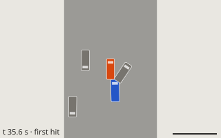
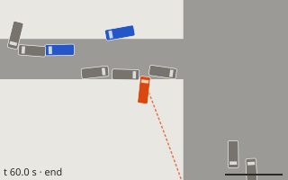
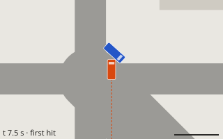

# Tuning dashboard integration notes

- **Workstream / prompt:** 20 — tuning dashboard (machine Q)
- **Branch:** `ws/tuning-dash`
- **Crates / folders owned:** `tools/tuning-dash/` (Rust crate `tuning-probe` in
  `tools/tuning-dash/probe`, Python `tuning_dash`, `web/`, `presets/`), `docs/TUNING.md`
- **Contract version built against:** 0.2.0 (merged `main` after lead run 3)

## Exposes
- `tools/tuning-dash/tune.py {sweep, presets, list, show, diff, promote, serve}` — see
  `tools/tuning-dash/README.md`; `just tune <spec>`, `just tune-dash`, `just tune-test`.
- Sweep spec format (YAML/JSON) and `out/sweeps/<name>/sweep.json` (format 1).
- `tuning-probe` CLI (`run <job.json>`, `resolve`, `diff`, `promote`) and library
  (`tuning_probe::{path, overrides, probe, promote, textedit, diff}`): parameter targets
  `<file>:<field path>` with selectors, in-memory overrides (`Overlay` implements
  `simcli::DataSource`), one-line text edits of JSON/TOML data files.
- `docs/TUNING_CHANGELOG.md` (created by the first promote): one line per promoted file.
- Presets: `tire_lateral_bcde`, `tire_longitudinal_bcde`, `spring_damper`, `arb_balance`,
  `impulse_to_lattice_scale`, `plasticity_scale`, `barrier_speeds`, `compare_sedan_coupe`,
  `damage_scenarios_plasticity`, `sedan_brakes`, `drivetrain_options` (v0.2.0 optional fields),
  `b_crush_arcade_table`, `b_crush_arcade_plasticity`, `b_crush_side_lattice` (crash-target study for B),
  `e_idle_ram_patrol`, `e_pursuit_aggression` (police studies for E, round 6b),
  `mode_hits_to_total_loss`, `b_arcade_total_loss_health` (mode semantics, round 6b).
- Probe kinds (round 6b): `pursuit` (city scenario with `data/police/*.toml` from the data root,
  targets `police:pursuit:…`; police contacts grouped into hits; same final hash as `simcli run`)
  and `survival` (repeated barrier-harness hits to total loss + single-hit total-loss speed).
- `pursuit` probe option `police_entities` (round 8): scenario entities treated as police cars
  (stand-ins held by their scripted inputs, no AI), and the fixture
  `tools/tuning-dash/scenarios/racer_into_stopped_cop.ron` (racer rear-ends a cop held stopped).
- Top-down SVG frames for `scenario` / `pursuit` points (`points/pNNNN/frames/fNN.svg`: first
  hard contact + 4 evenly spaced); the dashboard thumbnails and point detail use them.

## Needs
| from | what | why | workaround |
|---|---|---|---|
| 03 (B, damage) | `barrier::run_scenario_with(&BarrierScenario, &LoadedCar, &ModeTable)` (or `run_scenario` over a `simcli::DataSource`) | the probe applies overrides in memory; `run_scenario` only reads a data root on disk | `barrier_scenario` points copy cars/tires/lattices/materials/modes to a scratch folder (~ms) |
| 03 (B) | `DamageTuning` fields loadable from data (optional) | solver/buckle constants cannot be swept today | none; sweep `ModeTable`, materials and lattices instead |
| 10 (I, harness/CI) | run `python3 -m unittest discover -s tools/tuning-dash/tests` in CI (needs PyYAML) | the Python side is not covered by `cargo test` | `cargo test --workspace` covers the Rust probe; run `just tune-test` locally |
| 04 (C, testbed) | open a `replay.bin` by URL/path (`?replay=…`) | the dashboard links each scenario point's replay; a click-through would give a rendered view | top-down SVG frames drawn from the sim state (round 6b) |
| 10 (I, harness) or lead (simcli) | `simcli::run` takes the police tables from its `DataSource` (`police/*.toml`, falling back to `PoliceConfig::builtin()`), or a `RunOptions::police_config` | then the `pursuit` probe could use `simcli::run` instead of its own copy of the tick loop | the probe re-implements the loop; a unit test pins it to `simcli::run`'s final hash |

## Contract change requests
None. Everything goes through existing public APIs (`wp_contracts::parse_*`, `simcli`
`DataSource`/`run`/`load_car`/`load_mode`, `wp_vehicle::metrics`, `wp_damage::barrier`).

| # | Change (type / field / variant) | Why | Who is affected | Status |
|---|---|---|---|---|

## Changes outside my crates
- `Cargo.toml` (root): `tools/tuning-dash/probe` added to workspace members (`Cargo.lock`
  updated; no new external dependencies — serde, serde_json, toml, ron are workspace deps).
- `justfile`: recipes `tune`, `tune-dash`, `tune-test`.
- Nothing reachable from `wp_wasm` (the probe is a leaf tool crate). Round 6b: `tuning-probe`
  now also depends on `wp_sim` and `wp_police` (workspace crates; `Cargo.lock` updated).

## Perf numbers
| Measurement | Machine | Native | Browser | Budget |
|---|---|---|---|---|
| `vehicle_metrics` point (all but top speed) | cloud container, 4 cores | 0.3 s | — | — |
| `barrier` point, 5 speeds | cloud container | 0.1 s | — | — |
| `tire_lateral_bcde`, 40 points, 4 workers | cloud container | 2.7 s | — | — |
| `pursuit` point, 60 s observer soak (400 traffic agents, 13–18 police cars) | cloud container | 12 s | — | — |
| `e_idle_ram_patrol`, 27 points, 4 workers | cloud container | 2 min 43 s (round 6b) → 45 s (round 8) | — | — |
| `e_pursuit_aggression`, 36 points, 4 workers (round 8) | cloud container | 45 s | — | — |
| `mode_hits_to_total_loss`, 76 points, 4 workers (round 8) | cloud container | 13 s | — | — |
| `e_pursuit_aggression`, 36 points, 4 workers | cloud container | 1 min 16 s | — | — |
| `mode_hits_to_total_loss`, 64 points, 4 workers | cloud container | 10.9 s | — | — |

## Findings from the presets (for the owners; not changed here)
- **02 vehicle / skidpad metric** (re-measured on `main` after run 3; the `wp_vehicle`
  updates moved the numbers): `debug_sedan` skidpad `max_lat_g` is now 0.82 g at the file
  values (was 0.89; prompt 02 asks ~0.85) and is still not monotonic in lateral B
  (×0.8 → 0.815, ×1.0 → 0.822, ×1.1 → 0.872, ×1.2 → 0.826) while C and the understeer
  gradient move smoothly. Looks like the measurement (speed ramp / "1 s on the line"
  criterion) more than the tire; worth a look before anyone tunes B against skidpad g.
  Sweep: `tire_lateral_bcde`.
- **02 vehicle / power-on metric:** `debug_coupe` `power_on_curvature_ratio` = 36 (sedan
  0.65), unchanged after run 3; the coupe probably spins in the test, so the ratio is not meaningful there.
  Sweep: `compare_sedan_coupe`.
- **03 damage:** `plasticity_scale` 1.2 and 1.4 give identical crush/health at every speed
  (saturation somewhere); 0.6 breaks the calibration checks (frontal 56 km/h no longer a total
  loss; side door severity below range). Sweeps: `plasticity_scale`,
  `damage_scenarios_plasticity`.
- **03 damage:** `impulse_to_lattice_scale` 1.0–1.2 meets prompt 03's 56 km/h frontal target
  (0.57 / 0.69 m crush, TotalLoss, not at 25 km/h); 0.8 and below stop being a total loss at
  56. Sweep: `impulse_to_lattice_scale`.

## Study for 03 (B): crush vs the crash targets (requested by the lead, run 4)

**For B to review. No `wp_damage` data or code was changed.** Every number below comes from
full rigid-body simcli runs (Rapier contacts → `DamageSim`) on `main` after lead run 4, plus B's
own barrier-scenario checks. Reproduce with
`tools/tuning-dash/tune.py sweep b_crush_arcade_table` (and `b_crush_arcade_plasticity`,
`b_crush_side_lattice`), then `tune.py serve` for the interactive plots.

### Where things stand (data files as on `main`)
| case | mode | measured | target | |
|---|---|---|---|---|
| `golden_barrier_56kmh` (rigid wall) | Simulation | crush 0.96 m, health 0.18, 5 failed, **TotalLoss** | totals | ✓ already |
| `crash_barrier_frontal_sim` (testbed, 56 km/h) | Simulation | crush 1.56 m, health 0.12, 11 failed, **TotalLoss** | totals | ✓ already |
| `golden_frontal_56kmh` (parked sedan) | Simulation | crush 0.42 m, health 0.82, no TL | no TL | ✓ |
| `golden_tbone` victim | **Arcade** (as the golden is written) | **0.094 m, 0 failed** | 0.15–0.6 m, ≥ 1 failed (pending) | ✗ |
| `golden_tbone` victim, same scenario | Simulation | 0.33 m, 4 failed, no TL | 0.15–0.6 m, ≥ 1 failed | ✓ |

So the 56 km/h barrier already totals in Simulation, and the only miss is the **Arcade** T-bone.

### What moves the Arcade T-bone (and what it breaks)
Guardrails every point is checked against: Arcade 56 km/h rigid barrier must **not** total
("punishing but survivable"), and B's `side_arcade.ron` / `frontal_arcade.ron` calibration
checks; the lattice study also checks Sim T-bone, the Sim 56 km/h barrier and `side_sim.ron`.
Cells read victim crush / components failed (✕ = misses the target); barrier cells read crush,
final health, total-loss.

**1. `modes/arcade.toml`: `impulse_to_lattice_scale` × `component_fail_threshold_scale`**
(`b_crush_arcade_table`)

| impulse | fail_threshold | tbone victim (Arcade) | barrier 56 (Arcade) | side_arcade checks | frontal_arcade checks |
|---|---|---|---|---|---|
| 0.45 | 1.2 | 0.094 m / 0 failed  ✕ | 0.60 m, h 0.72, no TL | pass | pass |
| 0.45 | 1.5 | 0.094 m / 0 failed  ✕ | 0.60 m, h 0.72, no TL | pass | pass |
| 0.45 | 1.8 | 0.094 m / 0 failed  ✕ | 0.60 m, h 0.72, no TL | pass | pass |
| 0.55 | 1.2 | 0.109 m / 0 failed  ✕ | 0.64 m, h 0.66, no TL | pass | pass |
| 0.55 | 1.5 | 0.109 m / 0 failed  ✕ | 0.64 m, h 0.66, no TL | pass | pass |
| 0.55 | 1.8 | 0.109 m / 0 failed  ✕ | 0.64 m, h 0.66, no TL | pass | pass |
| 0.65 | 1.2 | 0.123 m / 1 failed  ✕ | 0.70 m, h 0.56, no TL | pass | FAIL: crush_m = 0.7779701 not in [0.3, 0.75]; health = 0.17854038 not in [0.2, 0.7] |
| 0.65 | 1.5 | 0.123 m / 0 failed  ✕ | 0.70 m, h 0.56, no TL | pass | FAIL: crush_m = 0.7779701 not in [0.3, 0.75] |
| 0.65 | 1.8 | 0.123 m / 0 failed  ✕ | 0.70 m, h 0.56, no TL | pass | FAIL: crush_m = 0.7779701 not in [0.3, 0.75] |
| 0.75 | 1.2 | 0.134 m / 2 failed  ✕ | 0.77 m, h 0.48, no TL | pass | FAIL: crush_m = 0.4660225 not in [0.2, 0.45]; health = 0.49696493 not in [0.55, 0.9]; crush_m =  |
| 0.75 | 1.5 | 0.134 m / 0 failed  ✕ | 0.77 m, h 0.48, no TL | pass | FAIL: crush_m = 0.4660225 not in [0.2, 0.45]; health = 0.49696493 not in [0.55, 0.9]; crush_m =  |
| 0.75 | 1.8 | 0.134 m / 0 failed  ✕ | 0.77 m, h 0.48, no TL | pass | FAIL: crush_m = 0.4660225 not in [0.2, 0.45]; health = 0.49696493 not in [0.55, 0.9]; crush_m =  |
| 0.85 | 1.2 | 0.150 m / 2 failed  ✕ | 0.82 m, h 0.37, no TL | pass | FAIL: crush_m = 0.31105042 not in [0.08, 0.3]; crush_m = 0.5251355 not in [0.2, 0.45]; health =  |
| 0.85 | 1.5 | 0.150 m / 1 failed  ✕ | 0.82 m, h 0.39, no TL | pass | FAIL: crush_m = 0.31105042 not in [0.08, 0.3]; crush_m = 0.5251355 not in [0.2, 0.45]; health =  |
| 0.85 | 1.8 | 0.150 m / 0 failed  ✕ | 0.82 m, h 0.39, no TL | pass | FAIL: crush_m = 0.31105042 not in [0.08, 0.3]; crush_m = 0.5251355 not in [0.2, 0.45]; health =  |
| 1.0 | 1.2 | 0.168 m / 2 failed  | 0.96 m, h 0.23, no TL | pass | FAIL: crush_m = 0.3497373 not in [0.08, 0.3]; crush_m = 0.6441133 not in [0.2, 0.45]; health = 0 |
| 1.0 | 1.5 | 0.168 m / 2 failed  | 0.96 m, h 0.23, no TL | pass | FAIL: crush_m = 0.3497373 not in [0.08, 0.3]; crush_m = 0.6441133 not in [0.2, 0.45]; health = 0 |
| 1.0 | 1.8 | 0.168 m / 0 failed  ✕ | 0.96 m, h 0.23, no TL | pass | FAIL: crush_m = 0.3497373 not in [0.08, 0.3]; crush_m = 0.6441133 not in [0.2, 0.45]; health = 0 |

**2. `modes/arcade.toml`: `plasticity_scale` × `impulse_to_lattice_scale`** (`b_crush_arcade_plasticity`)

| plasticity | impulse | tbone victim (Arcade) | barrier 56 (Arcade) | side_arcade checks | frontal_arcade checks |
|---|---|---|---|---|---|
| 0.8 | 0.45 | 0.094 m / 0 failed  ✕ | 0.60 m, h 0.72, no TL | pass | pass |
| 0.8 | 0.55 | 0.109 m / 0 failed  ✕ | 0.64 m, h 0.66, no TL | pass | pass |
| 0.8 | 0.65 | 0.123 m / 0 failed  ✕ | 0.70 m, h 0.56, no TL | pass | FAIL: crush_m = 0.7779701 not in [0.3, 0.75] |
| 1.0 | 0.45 | 0.097 m / 0 failed  ✕ | 0.59 m, h 0.70, no TL | pass | pass |
| 1.0 | 0.55 | 0.114 m / 0 failed  ✕ | 0.64 m, h 0.62, no TL | pass | pass |
| 1.0 | 0.65 | 0.128 m / 0 failed  ✕ | 0.69 m, h 0.53, no TL | pass | FAIL: health = 0.5459319 not in [0.55, 0.9]; crush_m = 0.7970381 not in [0.3, 0.75]; health = 0. |
| 1.25 | 0.45 | 0.099 m / 0 failed  ✕ | 0.60 m, h 0.69, no TL | pass | pass |
| 1.25 | 0.55 | 0.117 m / 0 failed  ✕ | 0.63 m, h 0.61, no TL | pass | pass |
| 1.25 | 0.65 | 0.136 m / 0 failed  ✕ | 0.70 m, h 0.52, no TL | pass | FAIL: health = 0.53380054 not in [0.55, 0.9]; crush_m = 0.8300266 not in [0.3, 0.75]; health = 0 |
| 1.5 | 0.45 | 0.099 m / 0 failed  ✕ | 0.60 m, h 0.69, no TL | pass | pass |
| 1.5 | 0.55 | 0.117 m / 0 failed  ✕ | 0.63 m, h 0.61, no TL | pass | pass |
| 1.5 | 0.65 | 0.136 m / 0 failed  ✕ | 0.70 m, h 0.52, no TL | pass | FAIL: health = 0.53380054 not in [0.55, 0.9]; crush_m = 0.8300266 not in [0.3, 0.75]; health = 0 |

**3. debug_sedan side cross-members (B's `cross_member` section) × Arcade impulse**
(`b_crush_side_lattice`; a lattice change affects both modes)

| cross_member_area | impulse | tbone victim (Arcade) | tbone victim (Sim) | barrier 56 (Arcade) | barrier 56 (Sim) | side_arcade checks | side_sim checks | frontal_arcade checks |
|---|---|---|---|---|---|---|---|---|
| 0.33 | 0.45 | 0.124 m / 0 failed  ✕ | 0.185 m / 3 failed  | 0.60 m, h 0.72, no TL | 1.06 m, h 0.13, TL | pass | FAIL: severity:LeftDoorF = 0.35020512 not in [0.4, 1] | pass |
| 0.33 | 0.55 | 0.149 m / 0 failed  ✕ | 0.185 m / 3 failed  | 0.67 m, h 0.63, no TL | 1.06 m, h 0.13, TL | pass | FAIL: severity:LeftDoorF = 0.35020512 not in [0.4, 1] | pass |
| 0.33 | 0.65 | 0.164 m / 0 failed  ✕ | 0.185 m / 3 failed  | 0.74 m, h 0.55, no TL | 1.06 m, h 0.13, TL | pass | FAIL: severity:LeftDoorF = 0.35020512 not in [0.4, 1] | FAIL: crush_m = 0.45873284 not in [0.2, 0.45]; crush_m = 0.8869766 not in [0.3, 0.75]; health =  |
| 0.5 | 0.45 | 0.106 m / 0 failed  ✕ | 0.392 m / 3 failed  | 0.60 m, h 0.72, no TL | 1.07 m, h 0.16, TL | pass | FAIL: severity:LeftDoorF = 0.35496056 not in [0.4, 1] | pass |
| 0.5 | 0.55 | 0.124 m / 0 failed  ✕ | 0.392 m / 3 failed  | 0.64 m, h 0.64, no TL | 1.07 m, h 0.16, TL | pass | FAIL: severity:LeftDoorF = 0.35496056 not in [0.4, 1] | pass |
| 0.5 | 0.65 | 0.141 m / 0 failed  ✕ | 0.392 m / 3 failed  | 0.73 m, h 0.55, no TL | 1.07 m, h 0.16, TL | pass | FAIL: severity:LeftDoorF = 0.35496056 not in [0.4, 1] | FAIL: crush_m = 0.8389976 not in [0.3, 0.75]; health = 0.19617912 not in [0.2, 0.7] |
| 0.67 | 0.45 | 0.097 m / 0 failed  ✕ | 0.324 m / 4 failed  | 0.60 m, h 0.72, no TL | 0.99 m, h 0.16, TL | pass | pass | pass |
| 0.67 | 0.55 | 0.113 m / 0 failed  ✕ | 0.324 m / 4 failed  | 0.65 m, h 0.65, no TL | 0.99 m, h 0.16, TL | pass | pass | pass |
| 0.67 | 0.65 | 0.127 m / 0 failed  ✕ | 0.324 m / 4 failed  | 0.71 m, h 0.55, no TL | 0.99 m, h 0.16, TL | pass | pass | FAIL: crush_m = 0.80820453 not in [0.3, 0.75]; health = 0.1984574 not in [0.2, 0.7] |
| 1.0 | 0.45 | 0.094 m / 0 failed  ✕ | 0.330 m / 4 failed  | 0.60 m, h 0.72, no TL | 0.96 m, h 0.18, TL | pass | pass | pass |
| 1.0 | 0.55 | 0.109 m / 0 failed  ✕ | 0.330 m / 4 failed  | 0.64 m, h 0.66, no TL | 0.96 m, h 0.18, TL | pass | pass | pass |
| 1.0 | 0.65 | 0.123 m / 0 failed  ✕ | 0.330 m / 4 failed  | 0.70 m, h 0.56, no TL | 0.96 m, h 0.18, TL | pass | pass | FAIL: crush_m = 0.7779701 not in [0.3, 0.75] |

### Reading
- Arcade victim crush rises only ~0.015 m per +0.1 `impulse_to_lattice_scale`; it reaches
  0.15 m at **0.85** (Simulation-like energy), and from **0.65** up B's own `frontal_arcade`
  checks fail (80 km/h crush 0.78 m > 0.75; at 0.85 the 40 km/h crush is out of range too).
  There is no Arcade-table value that meets 0.15 m and keeps the frontal calibration.
- `plasticity_scale` barely matters above 1.0 (0.117 → 0.117 m from 1.25 to 1.5: saturated,
  as in the earlier `plasticity_scale` preset). Not a useful knob for this target.
- `component_fail_threshold_scale` decides whether anything fails in the Arcade T-bone: the
  first failures appear at threshold **1.2** with impulse ≥ 0.65 (1 failed at 0.65, 2 at 0.75).
  At the current 1.8, nothing fails below impulse 0.85.
- Softening the side lattice helps Arcade (×0.33 → 0.149 m at impulse 0.55, still 0 failed) but
  breaks `side_sim.ron` (front-door severity 0.35 < 0.4 at ×0.5 and below). Sim T-bone crush is
  **not monotonic** in cross-member area (0.33 m at ×1.0, 0.39 at ×0.5, 0.185 at ×0.33): with
  softer cross-members the load path changes and the door/sill take less. Worth a look by B
  before using this knob at all.
- Every point keeps the Simulation 56 km/h barrier a total loss, and no point totals the Arcade
  56 km/h barrier (health ≥ 0.55 wherever the frontal checks still pass).

### Proposed values (for B to decide)
1. **Recommended: no data change; retarget the golden.** The 0.15–0.6 m / ≥ 1 failure T-bone
   target is a Simulation target (B reached the same conclusion in `damage.md`). Either switch
   `golden_tbone` to `mode: Simulation` (passes today: 0.33 m, 4 failed, no TL), or keep it
   Arcade with `crush_depth 0.05–0.25` and `components_failed 0–20` (passes today: 0.094 m).
   Owner of the golden: machine I; B confirms.
2. **If Arcade side hits must break something:** `component_fail_threshold_scale = 1.2`
   (was 1.8) with `impulse_to_lattice_scale = 0.65` (was 0.45) gives the Arcade T-bone victim
   0.123 m with 1 component failed, Arcade 56 km/h barrier health 0.56 (no TL), `side_arcade`
   passes. It needs B to widen `frontal_arcade.ron` at 80 km/h (crush ≤ 0.8 m, health ≥ 0.15;
   measured 0.778 m / 0.179) and to accept that Arcade frontal hits get ~45 % more crush. The
   T-bone crush target would still need lowering to ≥ 0.1 m.
3. **Not recommended:** reaching 0.15 m in Arcade through the table (impulse ≥ 0.85 makes
   Arcade crash like Simulation) or through cross-members (breaks `side_sim`, non-monotonic).

Promote is ready if B picks option 2 (`tune.py promote b_crush_arcade_table p0007` writes
both `arcade.toml` lines and the changelog line), but that is B's call and B's commit (goldens
change → `[bless]`).

## Known gaps
See `tools/tuning-dash/README.md` → Known gaps (frames are drawn from the sim state, not testbed renders;
`DamageTuning` is code; promote does not commit — owners commit data changes with `[bless]`).

## Lead feedback
(Written by the integration lead.)

_Run 3 (2026-10-19): no feedback items for this workstream; branch merged as-is._

### Done after run 3 (machine Q)
- Merged `main` (contract v0.2.0). `tuning-probe` needed no code change: it only uses
  `wp_contracts::parse_*`, `simcli` and the metric/barrier entry points, none of which broke.
- v0.2.0 adds optional data fields that most files leave out (`drivetrain.efficiency`,
  `wheels[*].inertia_kgm2`, `fuel_capacity_l`, `torque_converter`). Sweeps can now target
  them: `set` creates a missing optional leaf (the contract loader still rejects unknown
  fields) and promote inserts it into the file as a new member, matching the file's layout.
  New preset `drivetrain_options`; efficiency 0.85 reproduces the absent-field default
  exactly (sedan 0–100 8.125 s), which confirms `wp_vehicle` honours the field.
- Re-ran every preset on the merged physics (all run, no errors); findings below updated.

## Lead feedback (round 6b, 2026-10-19) — head-start tasks

Contract **v0.3.0** is being applied in parallel by the lead (branch `lead/contract-v0.3.0`). Do not edit `wp_contracts`; build your work so it drops onto v0.3.0 (inherent methods / local types now, trait wiring after). Merge `origin/claude/laughing-newton-0xqr6q` (the lead branch, ahead of `main` until today's gate finishes) before starting. Goal of the project right now: the **single-player greybox demo**: drive in the city, raise heat, get chased by physical police, escape or get caught, and pay the repair bill.

1. Pursuit tuning sweep: police aggression / ram parameters vs "police ram a stopped car" (the observer soak issue E is fixing). Report which parameter ranges keep pursuits physical without wrecking idle cars. Findings go to E; don't change their data.
2. Damage mode sweep: Arcade vs Simulation, total-loss speed per car class. Report hits-to-total-loss per mode against the CLAUDE.md mode semantics.
3. Thumbnails as frames (known gap), if cheap.

## Round 6b (machine Q): done

All three head-start items are done. Merged `origin/main` and `origin/claude/laughing-newton-0xqr6q`
(clean). No other workstream's data or code was changed; everything below is a finding for its
owner. Reproduce any table with `tools/tuning-dash/tune.py sweep <preset>` and look at it with
`tune.py serve`.

### 1. Police ramming stopped cars: patrol and pursuit values (for E, 07)

**New tooling.** simcli builds police from the tables compiled into `wp_police`, so the probe
could not sweep `data/police/*.toml` through it. The new `pursuit` probe builds the sim with
`simcli::run::build_sim`, installs a `PoliceSystem` made from the (overridden) data files, and
runs simcli's tick loop. With no overrides it ends on the same state hash as `simcli run` (unit
test). Every police contact is grouped into a **hit** (contact gap ≤ 0.25 s) recording the struck
body, both speeds just before, the largest closing speed, and the unit's assignment and tactic.
A struck car under 1 m/s counts as stopped.

**It reproduces your report.** In `soak/traffic_soak_observer` with `police_cars: true` (seed 5,
file values), a patrol car rear-ends the parked observer at 35.6 s, closing at 10.8 m/s, and hits it
3 times in all. In the same run police also hit **stopped traffic 23 times** (the worst at
24.5 m/s, a patrol car at full speed into a car waiting at a light), hit each other 6 times and
hit world objects 21 times. One unit wrecks itself.

**`e_idle_ram_patrol`** varies `pursuit.toml` `patrol_speed_factor` × `unit.brake_mps2`, with 3 seeds
per cell, on the observer soak (no heat). The table shows the mean over the seeds, and the maximum
for closing speed:

| patrol_speed_factor | brake_mps2 | hits on the stopped observer | hits on stopped traffic | max closing on a stopped car | police↔police | units disabled |
|---|---|---|---|---|---|---|
| 0.6 | 4.5 / 6.5 / 9.0 | 0.33 / 0.33 / 0.33 | 13.7 / 18.3 / 16.3 | 14.8 m/s | 3.0 / 6.0 / 8.0 | 1.7–2.0 |
| 0.8 | 4.5 / 6.5 / 9.0 | 1.33 / 1.33 / 1.67 | 14.3 / 15.3 / 13.0 | 19.1 m/s | 6.3 / 2.7 / 11.7 | 1.7–2.3 |
| 1.0 (file) | 4.5 / 6.5 (file) / 9.0 | 0.67 / 1.33 / 3.33 | 6.0 / 12.3 / 7.7 | 24.6 m/s | 13.3 / 6.0 / 17.0 | 2.7–4.0 |

What this shows:
- **No value in these ranges keeps idle cars safe.** Every one of the 27 runs has police hitting
  a stopped car (3 to 34 hits on stopped traffic per run). Without obstacle awareness, tuning only
  changes how hard the hits are. Your planned fix (slow or stop behind any vehicle ahead) is the
  real fix.
- **`patrol_speed_factor` sets how hard the hits are.** The worst closing speed on a stopped car is
  14.8 m/s at 0.6, 19.1 m/s at 0.8 and 24.6 m/s at 1.0. The observer takes 0–1 hits at 0.6 against
  0–8 at 1.0. If you want a stop-gap before avoidance lands, **0.6–0.7** roughly halves the impact
  energy. It has a cost: the slower units spend longer in traffic, and hits on stopped traffic
  *rise* (mean 16 at 0.6 against 9 at 1.0).
- **`unit.brake_mps2` has no consistent effect** on hits on stopped cars; the spread between seeds
  is larger than any brake trend. Stronger brakes go with more police↔police hits at 1.0 (17 at
  9.0). Leave it at 6.5.
- Seeds matter more than either knob: hit counts range 3–34 for the same values. Any done-check
  for the obstacle fix should use several seeds (this preset runs 3).

**`e_pursuit_aggression`** varies `target_speed_margin` × `tactics.pit_max_kmh.arcade` ×
`tactics.pit_min_straight_m` in two cases:
- **chase:** `golden/city_chase` re-aimed so the racer drives north, away from the parked patrol
  car, at noon with starting heat 55 (wanted level 3).
- **wanted, stopped:** the observer soak car parked with heat 55.

Every run starts a pursuit at 0.3 s.

| case | margin | pit_max_kmh | pit_straight_m | PIT attempts | closest pursuer after 3 s | contact with the target | hits on stopped cars | police↔police | units disabled |
|---|---|---|---|---|---|---|---|---|---|
| chase | 0.0 | any | any | 0 | 59 m | none | 3 | 2 | 1 |
| chase | 0.1 (file) | any | any | 0 | 7.7 m | none | 2 | 1 | 2 |
| chase | 0.25 | any | any | 0 | 8.5 m | none | 1 | 2 | 1 |
| wanted, stopped | any | any | any | 0 | 7.8 m | **none** | 31 (traffic) | 11 | 6 |

What this shows:
- **Pursuits are not physical yet: no PIT, box-in or contact with the racer at any setting.**
  Every police hit in these runs happens while the unit is in tactic `Shadow`. PIT stays off even
  with `pit_max_kmh` raised to 110 (the chase racer does 79 km/h, above the Arcade default of 70)
  and `pit_min_straight_m` lowered to 25. The block is therefore one of the code gates in
  `pursuit.rs` (around line 696: `rank == 0`, `straight_ahead` needing a track radius ≥ 300 m along
  the racer's track, the risk budget, `gap < 40`). A unit test with a racer on a straight
  collector at 60 km/h and one unit 20 m behind would show which gate. `pit_engage_m` was also
  tried (12 / 25) and made no difference either.
- **`target_speed_margin` must stay above 0.** At 0 the pursuer never gets closer than 59 m; at
  0.1–0.25 it gets to about 8 m. 0.1 (the file value) is fine.
- **Stopped wanted cars are not rammed (good):** pursuers stop about 8 m away. The damage happens
  on the way there: the converging roadblock and spike units and reinforcements hit stopped
  traffic 31 times and each other 11 times, and 6 units are disabled. The obstacle fix should
  cover units on `RoadblockAt` / `SpikeAt` assignments as well as patrols. In the hit lists those
  units hit things while barely moving (0.3–0.8 m/s before the contact, then 3–11 m/s closing);
  they look like they are being shoved while parking.
- When the obstacle fix lands, re-run both presets. They are written as done-checks: the expects
  require 0 hits on stopped cars, and for the wanted case a closing speed on the suspect of at
  most 5 m/s.

### 2. Damage modes vs the CLAUDE.md semantics: hits to total loss per car (for B, 03)

**New tooling.** The new `survival` probe repeats the `wp_damage` barrier-harness impact on one
already-damaged model until it is a total loss (cap 12 hits) at each speed. It also finds the
lowest single-hit total-loss speed (scan 10–200 km/h, then bisect to 1 km/h). A hard hit is
56 km/h into a rigid barrier (frontal), or a same-mass car into the side. Caveat: later hits load
the rest-geometry footprint again, so they test "same wall, same face, again".

**`mode_hits_to_total_loss`** covers all 16 cars × both modes × frontal and side. Each cell reads:
single-hit total-loss speed (km/h) / hits to total loss at 40 / 56 / 80 km/h / health after one
56 km/h hit. "—" means never within the scan or the 12-hit cap. ✕ marks a failed check: Arcade
frontal at 56 must degrade the car (health ≤ 0.9) and end it in 2–6 hits; Simulation frontal at 56
must end it in 1.

| car | class | Arcade frontal | Simulation frontal | Arcade side | Simulation side |
|---|---|---|---|---|---|
| debug_coupe | Sport | — / — / — / 5 / 0.75 ✕ | 54 / 2 / 1 / 1 / 0.18 | — / — / — / — / 0.84 | 51 / 2 / 1 / 1 / 0.58 |
| debug_sedan | Compact | 190 / — / — / 6 / 0.76 ✕ | 55 / 2 / 1 / 1 / 0.20 | — / — / — / — / 0.84 | 47 / 2 / 1 / 1 / 0.59 |
| hakone_gt | Sport | — / — / 8 / 4 / 0.70 ✕ | 50 / 2 / 1 / 1 / 0.13 | — / — / — / — / 0.83 | 62 / 3 / 2 / 1 / 0.53 |
| hauler_1500 | Truck | 181 / — / 12 / 9 / 0.69 ✕ | 50 / 3 / 1 / 1 / 0.17 | 200 / — / — / — / 0.84 | 65 / 3 / 2 / 1 / 0.54 |
| ironside_440 | Muscle | — / — / — / 7 / 0.71 ✕ | 52 / 2 / 1 / 1 / 0.20 | — / — / — / — / 0.84 | 62 / 2 / 2 / 1 / 0.54 |
| junkyard_beater | Beater | 113 / 10 / 5 / 3 / 0.68 | 50 / 2 / 1 / 1 / 0.13 | 189 / — / — / — / 0.83 | 54 / 2 / 1 / 1 / 0.53 |
| kestrel_ts | Sport | 113 / 10 / 5 / 3 / 0.70 | 50 / 2 / 1 / 1 / 0.13 | 190 / — / — / — / 0.83 | 54 / 2 / 1 / 1 / 0.52 |
| lindwurm_4t | Sport | 119 / 9 / 5 / 3 / 0.67 | 48 / 2 / 1 / 1 / 0.10 | — / — / — / — / 0.83 | 59 / 2 / 2 / 1 / 0.52 |
| lucciola_350 | Exotic | — / — / — / 8 / 0.62 ✕ | 50 / 2 / 1 / 1 / 0.19 | 188 / — / — / — / 0.81 | 55 / 2 / 1 / 1 / 0.49 |
| rampart_50 | Muscle | — / — / 8 / 4 / 0.71 ✕ | 50 / 2 / 1 / 1 / 0.13 | — / — / — / — / 0.83 | 59 / 2 / 2 / 1 / 0.52 |
| sentinel_bastion | PoliceSuv | 186 / — / — / 4 / 0.66 ✕ | 52 / 2 / 1 / 1 / 0.20 | — / — / — / — / 0.83 | 59 / 2 / 2 / 1 / 0.53 |
| sentinel_cruiser | PoliceCruiser | — / — / — / 6 / 0.72 ✕ | 54 / 3 / 1 / 1 / 0.23 | — / — / — / — / 0.84 | 62 / 3 / 2 / 1 / 0.54 |
| sentinel_wolfhound | PoliceInterceptor | 190 / — / 12 / 5 / 0.70 ✕ | 53 / 2 / 1 / 1 / 0.22 | 200 / — / — / — / 0.83 | 62 / 3 / 2 / 1 / 0.54 |
| shiro_turbo | Sport | 187 / 12 / 9 / 5 / 0.70 ✕ | 51 / 2 / 1 / 1 / 0.14 | — / — / — / — / 0.83 | 61 / 3 / 2 / 1 / 0.53 |
| sperber_32 | Sport | 175 / — / 12 / 6 / 0.68 ✕ | 50 / 2 / 1 / 1 / 0.13 | — / — / — / — / 0.83 | 55 / 2 / 1 / 1 / 0.53 |
| vireo_xs | Compact | 115 / 8 / 4 / 3 / 0.66 | 49 / 2 / 1 / 1 / 0.10 | 196 / — / — / — / 0.83 | 57 / 2 / 2 / 1 / 0.53 |

How this compares with CLAUDE.md:
- **Simulation meets "one hard hit at speed is a total loss" for every car.** A frontal hit
  totals the car from 48–55 km/h, and 56 km/h always takes one hit. A 25 km/h knock does not total
  any car, and two or three 40 km/h hits do. Side hits total from 47–65 km/h; 10 of 16 cars need two
  same-mass side hits at 56 km/h (all of them need one at 80). That is plausible, since a car-to-car
  side hit transfers half the energy of a rigid wall.
- **Arcade meets "one hard hit degrades"** (health 0.62–0.76 after one 56 km/h frontal hit) **but
  fails "several end the car" for 12 of 16 cars.** Their health levels off just above
  `total_loss_health = 0.10`: the sedan reads 0.76, 0.45, 0.25, 0.20, 0.17, 0.12, 0.109, 0.106,
  0.104, … after successive 56 km/h hits and never crosses. Only the four lighter cars (Beater,
  Kestrel, Lindwurm, Vireo) end in 4–5 hits. `arcade.toml`'s own header promises "two or three
  hard hits end the car".
- **Arcade side impacts never total any car** (health levels off around 0.8 after the first hit;
  more hits barely move it). The side lattice or the side component mapping saturates in Arcade.
  This matches the earlier T-bone study (Arcade victim crush stuck near 0.1 m).

**`b_arcade_total_loss_health`** sweeps `modes/arcade.toml:total_loss_health`, the one Arcade
value that moves this without touching Simulation. Cells are hits to total loss at 40 / 56 / 80 km/h:

| car / impact | 0.10 (file) | 0.15 | 0.20 | 0.25 | 0.30 |
|---|---|---|---|---|---|
| debug_sedan frontal | — / — / 6 | 12 / 6 / 3 | 8 / 4 / 2 | 7 / 3 / 2 | 6 / 3 / 2 |
| ironside_440 frontal | — / — / 7 | — / 6 / 3 | 8 / 4 / 2 | 7 / 4 / 2 | 6 / 3 / 2 |
| hauler_1500 frontal | — / 12 / 9 | — / 7 / 5 | — / 5 / 2 | 9 / 3 / 2 | 6 / 3 / 1 |
| sentinel_cruiser frontal | — / — / 6 | — / 8 / 4 | 9 / 5 / 3 | 7 / 4 / 2 | 5 / 3 / 2 |
| debug_sedan side | never | never | never | never | never |
| ironside_440 side | never | never | never | never | 11 / 5 / 3 |

**Proposed for B to decide (not promoted):** Arcade `total_loss_health` **0.20–0.25**. That gives
3–5 hard frontal hits to total loss across Compact, Muscle, Truck and police cruiser, keeps
single-hit health unchanged (one hit still only degrades), and keeps a single 80 km/h hit
survivable at 0.20 (2–3 hits). The single-hit total-loss speed falls from ~190 to 101–118 km/h at
0.20 (87–92 at 0.25), so Arcade stays well above Simulation's ~52 km/h. To promote:
`tune.py promote b_arcade_total_loss_health <point>` writes the line and the changelog entry.
That is B's call and B's commit (`[bless]`, since the goldens may move). The Arcade **side**
result needs a model or lattice look; no threshold below 0.3 fixes it.

Also for B: after this round's damage merge, Simulation `plasticity_scale` is no longer
monotonic in crush. For the debug_sedan 56 km/h frontal, 0.8 gives 0.639 m and 1.0 gives 0.634 m,
so less plasticity now means slightly *more* crush. That broke an old tuning-dash test, which now
sweeps `impulse_to_lattice_scale` instead. It fits the saturation reported in "Findings from the
presets".

### Session checks (round 6b)
`cargo fmt`, `cargo clippy --workspace --all-targets -D warnings` are clean. `cargo test
-p tuning-probe` passes (22 tests), and `python3 -m unittest discover -s tools/tuning-dash/tests`
passes (10 tests). `cargo test --workspace --no-fail-fast`: 578 passed, **2 failed, both outside
this workstream and already failing on the merged lead/main state** (this branch changes only
`tools/tuning-dash`, docs, and tuning-probe's `Cargo.lock` entry):
- `wp_economy` `tests/pursuit_wiring.rs::real_police_capture_settles_through_the_economy` (line 130)
- `wp_race` `tests/simcli_races.rs::city_sprint_on_real_roads` (line 28)

One workspace test binary takes about 55 minutes in a debug build on this 4-core container.

### 3. Thumbnails as frames (known gap): done

`scenario` and `pursuit` points now write top-down SVG frames: one at the first hard contact of a
scenario car (closing speed ≥ 3 m/s) and four evenly spaced, the last at the end. They are drawn
from the simulation state (roads, building footprints, barriers, every vehicle as an oriented box
coloured by driver, scenario-car trails), so they cost microseconds and need no browser. The
points table shows the first-hit frame (else the last) as the thumbnail, and the point detail
shows the strip with captions (`info.frames`). The two images above are frames from
`e_idle_ram_patrol`. They are boxes on a map, not testbed renders: no deformation or lighting.

## Lead feedback (round 8, 2026-10-19)
1. **Restore `pursuit::tests::racer_contact_classified`**, which the lead marked `#[ignore]` in round 8. `golden/city_chase` was re-aimed after contract v0.3.0 moved patrol spawns, and since E round 6 police no longer stop in the racer lane, so the 0.5 s rear-end no longer happens. Build a deliberate setup (your own scenario in `tools/tuning-dash`, for example a racer driving into a police unit held stopped) and un-ignore the test.
2. Re-run your pursuit and damage sweeps on the merged `main`, which now has H's cruiser package, B's Arcade split, E's avoidance and radio throttling. Report what changed.

## Round 8 (machine Q): done

Merged `origin/main` (clean). Both items are done. No other workstream's code or data was changed;
the findings below are for their owners. Reproduce with `tools/tuning-dash/tune.py sweep
tools/tuning-dash/presets/<preset>.yaml` and browse with `tune.py serve`.

### 1. `pursuit::tests::racer_contact_classified` restored (un-ignored)

The test now runs on a deliberate fixture, `tools/tuning-dash/scenarios/racer_into_stopped_cop.ron`:
same city and lane as `golden/city_chase`, no AI police, traffic or parked cars, a racer cruising
at 16.5 m/s and a `sentinel_cruiser` 25 m ahead held on brake + handbrake. The racer brakes after the
hit so it does not keep pushing. The new probe option `police_entities: ["cop"]` marks that entity
as a police car (`Sim::set_vehicle_kind`, which changes no physics and adds no AI). The test checks
that there is exactly one hit, at about 1.24 s, with the racer at > 15 m/s, the police car at < 1 m/s,
classified as `hits_moving_scenario = 1` and `hits_stopped_scenario = 0`. A second test checks that an
unknown `police_entities` id is an error. The Python end-to-end pursuit test moved to the same fixture.
`same_final_hash_as_simcli_run` still runs on `golden/city_chase`.

### 2. Sweeps re-run on merged `main` (H cruiser package, B Arcade split, E avoidance, radio throttling)

#### Police ramming stopped cars (`e_idle_ram_patrol`, for E): fixed

| patrol_speed_factor | brake_mps2 | hits on the stopped observer | hits on stopped traffic | max closing on a stopped car | police↔police | units disabled |
|---|---|---|---|---|---|---|
| 0.6 | 4.5 / 6.5 / 9.0 | 0 / 0 / 0 | 0 / 0.33 / 0.33 | 0.1 m/s | 0 | 0 |
| 0.8 | 4.5 / 6.5 / 9.0 | 0 / 0 / 0 | 0 / 0 / 0 | 0 | 0 | 0 |
| 1.0 (file) | 4.5 / 6.5 (file) / 9.0 | 0 / 0 / 0 | 0 / 0 / 0 | 0 | 0 | 0 |

- **At the file values, all 3 seeds pass the done-check** (0 hits on stopped cars). Round 6b had
  1.3 hits on the observer, 12.3 on stopped traffic, up to 24.6 m/s closing, 6 police↔police hits
  and 3–4 units disabled per run. The only remaining "stopped" contacts are two 0.1 m/s touches at
  `patrol_speed_factor` 0.6. The stop-gap of 0.6–0.7 suggested in round 6b is no longer needed:
  keep 1.0.
- What is left is 1–5 **world contacts per run at 0.3–4.4 m/s**, all patrols in `Shadow`: kerbs or
  props on corners. They are minor, but they are the next thing to look at if patrols should be
  clean.
- The sweep is 3.6× faster (45 s, was 2 min 43 s): far fewer contacts to resolve.

#### Pursuit aggression (`e_pursuit_aggression`, for E)

The chase case is **re-aimed**. Round 6b started the racer at (56.75, 40) next to a parked patrol.
After v0.3.0 moved the spawns, no unit saw the racer there (the closest pursuer stayed 116 m away), so
units drove at the 10 m/s floor of `pursuit_speed_cap` and every knob did nothing. The preset now uses
the golden's own start (x = 59.75, y = -175, northbound) at noon with heat 55.

| case | any margin / pit_max_kmh / pit_straight_m | PIT attempts | closest pursuer after 3 s | contacts with the target | hits on stopped cars | police↔police | world | units disabled | target health |
|---|---|---|---|---|---|---|---|---|---|
| chase | identical for all 18 points | 0 | 3.7 m | 3 (max 12.1 m/s) | 1 (traffic, 14.7 m/s) | 0 | 0 | 1 | 0.84 |
| wanted, stopped | identical for all 18 points | 0 | 7.9 m | 0 | 3 (police cars) | 3 | 8 | 1 | 1.00 |

- **Wanted, stopped: much better.** 0 hits on stopped traffic (was 31), 3 police↔police (was 11),
  1 unit disabled (was 6). The suspect is still not rammed: pursuers stop about 8 m away. Its
  done-check (closing on the suspect ≤ 5 m/s) passes. The hits on stopped police cars are units
  bumping into each other while they park around the suspect.
- **Chase: the police now reach the racer, but the contact is the wrong way round.** At 7.5 s the
  racer (16.3 m/s) rear-ends a unit that is on `Pursue`/`Shadow` and **stopped dead in the racer's
  lane** (0 m/s). That unit is disabled. Likely cause, from `pursuit.rs` (Shadow branch): the speed
  is `sp = v_r + 0.6 * (gap - want_gap)`, with `want_gap` = 32.5 m (the middle of `shadow_m`) and
  clamped at 0. A unit within about 5 m of the racer along the track (alongside or just ahead) gets
  `sp ≤ 0` and brakes to a stop in front of the racer to "drop back". Suggestion: when `gap < want_gap`,
  limit the drop-back to some fraction below `v_r` (for example `max(sp, 0.7 * v_r)`), or move the
  unit sideways out of the lane, instead of stopping it.
- **A disabled unit reverses at 14.6 m/s into stopped traffic.** At 13.7 s the unit that was disabled at
  7.5 s (assignment `OutOfService`) hits a stopped traffic car closing at 14.7 m/s, with its own
  speed at **−14.6 m/s (driving backwards)**. Out-of-service units should stop and hold (or the car
  should get zero throttle once the unit is disabled). Reproduce: `e_pursuit_aggression` point
  `p0008`, `info.hits`.
- **Still no PIT, box-in or rolling block, and every knob is inert in both cases** (one final hash for
  all 18 points per case). `target_speed_margin` only feeds the cap, and a Shadow unit's own
  speed stays below it. PIT is never chosen at any `pit_max_kmh` or straight length. Possible
  contributor next to the gates listed in round 6b: `active` is sorted by ascending gap, so `rank == 0`
  goes to the unit furthest *ahead* of or level with the racer, not to the one behind it that could
  PIT. The pursuit lasts 7.2 s of 30 (the only pursuer is disabled at 7.5 s).

#### Damage modes (`mode_hits_to_total_loss`, for B and H)

Now 19 cars: H's `drayman_cargo` (Truck), `furrow_24` (Truck) and `tansy_13` (Compact) were added to
the preset. Cell format as in round 6b: single-hit total-loss speed (km/h) / hits to total loss at
40 / 56 / 80 km/h / health after one 56 km/h hit; "—" means never (within 200 km/h or 12 hits);
✕ marks a failed check.

| car | class | Arcade frontal | Simulation frontal | Arcade side | Simulation side |
|---|---|---|---|---|---|
| debug_coupe | Sport | — / — / — / 5 / 0.75 ✕ | 54 / 2 / 1 / 1 / 0.18 | — / — / — / — / 0.84 | 51 / 2 / 1 / 1 / 0.58 |
| debug_sedan | Compact | 190 / — / — / 6 / 0.76 ✕ | 55 / 2 / 1 / 1 / 0.20 | — / — / — / — / 0.84 | 47 / 2 / 1 / 1 / 0.59 |
| hakone_gt | Sport | — / — / 9 / 3 / 0.71 ✕ | 51 / 2 / 1 / 1 / 0.20 | — / — / — / — / 0.82 | 50 / 2 / 1 / 1 / 0.52 |
| hauler_1500 | Truck | — / — / 12 / 6 / 0.70 ✕ | 51 / 2 / 1 / 1 / 0.15 | — / — / — / — / 0.82 | 56 / 2 / 1 / 1 / 0.52 |
| ironside_440 | Muscle | — / — / 8 / 9 / 0.71 ✕ | 52 / 2 / 1 / 1 / 0.21 | 183 / — / — / — / 0.83 | 50 / 2 / 1 / 1 / 0.54 |
| junkyard_beater | Beater | 123 / — / 6 / 3 / 0.68 | 50 / 2 / 1 / 1 / 0.10 | 185 / — / — / — / 0.81 | 47 / 2 / 1 / 1 / 0.56 |
| kestrel_ts | Sport | 126 / — / 6 / 3 / 0.74 | 51 / 2 / 1 / 1 / 0.15 | 197 / — / — / — / 0.81 | 46 / 2 / 1 / 1 / 0.55 |
| lindwurm_4t | Sport | 120 / — / 6 / 3 / 0.68 | 48 / 2 / 1 / 1 / 0.10 | — / — / — / — / 0.82 | 49 / 2 / 1 / 1 / 0.52 |
| lucciola_350 | Exotic | — / — / 8 / 4 / 0.59 ✕ | 50 / 2 / 1 / 1 / 0.19 | 192 / — / — / — / 0.79 | 45 / 2 / 1 / 1 / 0.47 |
| rampart_50 | Muscle | — / — / 7 / 4 / 0.72 ✕ | 52 / 2 / 1 / 1 / 0.19 | — / — / — / — / 0.82 | 48 / 2 / 1 / 1 / 0.52 |
| sentinel_bastion | PoliceSuv | — / — / — / 6 / 0.69 ✕ | 52 / 2 / 1 / 1 / 0.22 | 199 / — / — / — / 0.82 | 51 / 2 / 1 / 1 / 0.54 |
| sentinel_cruiser | PoliceCruiser | — / — / — / 7 / 0.79 ✕ | **62 / 3 / 2 / 1 / 0.37 ✕** | — / — / — / — / 0.85 | 55 / 2 / 1 / 1 / 0.61 |
| sentinel_wolfhound | PoliceInterceptor | — / — / 12 / 8 / 0.74 ✕ | 56 / 2 / 1 / 1 / 0.25 | — / — / — / — / 0.82 | 52 / 2 / 1 / 1 / 0.55 |
| shiro_turbo | Sport | — / — / 10 / 7 / 0.71 ✕ | 51 / 2 / 1 / 1 / 0.16 | — / — / — / — / 0.82 | 49 / 2 / 1 / 1 / 0.54 |
| sperber_32 | Sport | — / — / 10 / 7 / 0.71 ✕ | 51 / 2 / 1 / 1 / 0.12 | 198 / — / — / — / 0.81 | 46 / 2 / 1 / 1 / 0.54 |
| vireo_xs | Compact | 115 / — / 6 / 2 / 0.70 | 48 / 2 / 1 / 1 / 0.10 | 190 / — / — / — / 0.82 | 48 / 2 / 1 / 1 / 0.54 |
| drayman_cargo | Truck | 189 / — / 8 / 7 / 0.67 ✕ | 51 / 2 / 1 / 1 / 0.20 | — / — / — / — / 0.81 | 47 / 2 / 1 / 1 / 0.55 |
| furrow_24 | Truck | 184 / — / 9 / 4 / 0.66 ✕ | 49 / 2 / 1 / 1 / 0.15 | 194 / — / — / — / 0.82 | 53 / 2 / 1 / 1 / 0.52 |
| tansy_13 | Compact | 127 / — / 6 / 2 / 0.68 | 47 / 2 / 1 / 1 / 0.10 | — / — / — / — / 0.82 | 49 / 2 / 1 / 1 / 0.54 |

What changed since round 6b:
- **Simulation: H's tougher cruiser breaks "one hard hit at speed is a total loss".**
  `sentinel_cruiser` now keeps 0.37 health after a 56 km/h frontal (was 0.23), needs 2 hits, and
  its single-hit total-loss speed is 62 km/h (was 54). Every other car still totals in one 56 km/h
  hit (47–56 km/h). For H and B: if the cruiser is meant to be tougher than civilian cars in
  Simulation, CLAUDE.md's rule needs a "police cars excepted" note. Otherwise the package should
  keep the Simulation 56 km/h hit fatal (for example by toughening only the Arcade side of it).
- **Simulation side impacts are now one-hit total losses for every car** (side total-loss speed
  45–56 km/h, was 47–65; in round 6b 10 of 16 cars needed two same-mass side hits at 56 km/h).
- **Arcade (B's split): 40 km/h hits are now cosmetic for every car**, which is B's intent (no car
  is ever totalled by 40 km/h hits; round 6b's light cars ended in 8–10). One 56 km/h hit still
  only degrades (health 0.59–0.79). "Several hits end the car" still fails at 56 km/h for **14 of
  19 cars** (round 6b: 12 of 16). Ten of them end in 7–12 hits (ironside and lucciola newly so;
  they never ended before), while coupe, sedan, bastion and cruiser never end at 56 km/h. The five
  lightest (Beater, Kestrel, Lindwurm, Vireo, Tansy) now take 6 hits (was 4–5).
- `ironside_440` Arcade is **non-monotonic**: 8 hits at 56 km/h but 9 at 80 km/h. Worth a look by B
  (the 80 km/h hits may saturate the same front lattice region sooner).
- Arcade side impacts still never total any car (health levels off around 0.8).

**`b_arcade_total_loss_health`** (Arcade only). Cells: hits to total loss at 40 / 56 / 80 km/h
(single-hit total-loss speed). Health after one 56 km/h hit does not depend on the threshold (sedan 0.76,
ironside 0.71, hauler 0.70, cruiser 0.79).

| car / impact | 0.10 (file) | 0.15 | 0.20 | 0.25 | 0.30 |
|---|---|---|---|---|---|
| debug_sedan frontal | — / — / 6 (190) | — / 6 / 3 (128) | — / 4 / 2 (102) | — / 3 / 2 (90) | — / 3 / 2 (88) |
| ironside_440 frontal | — / 8 / 9 (—) | — / 6 / 3 (129) | — / 4 / 3 (110) | — / 4 / 2 (95) | — / 3 / 2 (83) |
| hauler_1500 frontal | — / 12 / 6 (—) | — / 6 / 3 (135) | — / 4 / 2 (100) | — / 3 / 2 (82) | — / 3 / 1 (80) |
| sentinel_cruiser frontal | — / — / 7 (—) | — / 10 / 5 (162) | — / 7 / 3 (134) | — / 6 / 3 (111) | — / 4 / 2 (93) |
| debug_sedan side | never | never | never | never | never (189) |
| ironside_440 side | never (183) | never (183) | never (183) | never (140) | never (132) |

For B: the 0.23 that B proposes (blocked on G's career proxy) still fits. At 0.20–0.25, sedan,
Muscle and Truck end in 3–4 hard hits and survive one 80 km/h hit. The cruiser needs 6–7 hits at
0.20–0.25 and only falls inside "2–6" at 0.30. That is the Arcade side of the same cruiser
toughness question. 40 km/h hits never total any car at any threshold, which matches the split.

### Session checks (round 8)
See the end of this section (filled in after the run).
